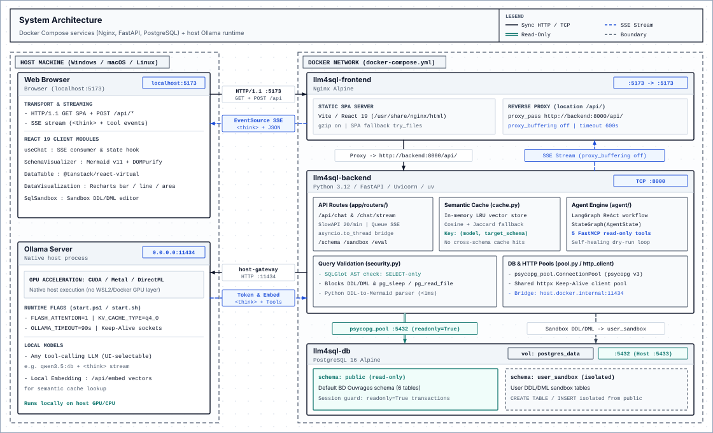
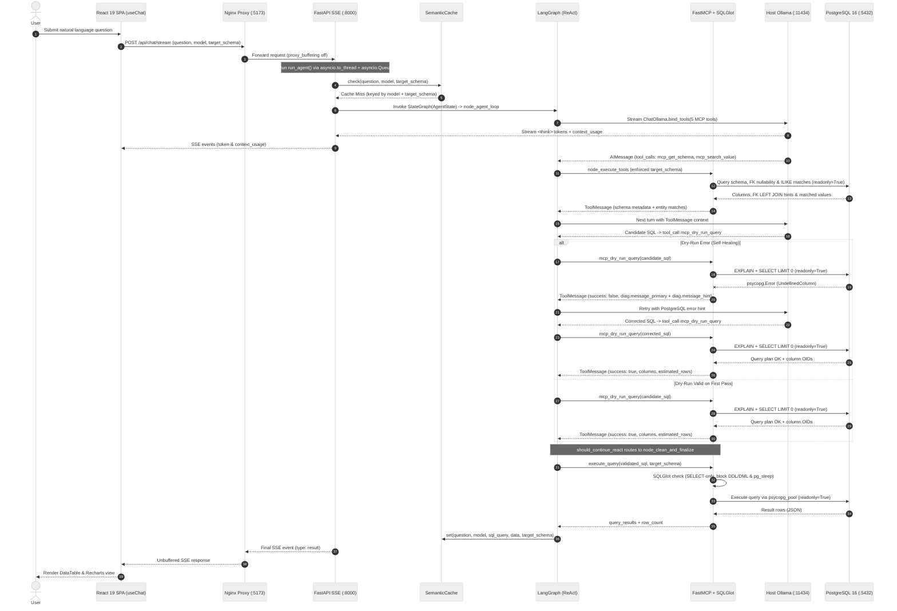

# Architecture

## Overview

LLM4SQL translates natural language questions into PostgreSQL queries using a local Ollama model orchestrated by LangGraph:

- **ReAct tool loop**: `StateGraph(AgentState)` binds 5 read-only `FastMCP` tools (`mcp_list_tables`, `mcp_get_schema`, `mcp_search_value`, `mcp_get_sample_data`, `mcp_dry_run_query`) so the model inspects real columns, foreign keys, and cell values instead of guessing.
- **Read-only SQL enforcement**: `sqlglot` parses every SQL query into an AST, permits `SELECT` statements only, and blocks DDL/DML (`INSERT`, `UPDATE`, `DELETE`, `DROP`, `ALTER`, `TRUNCATE`) plus dangerous functions (`pg_sleep`, `pg_read_file`). `psycopg` v3 runs analytical queries inside `readonly=True` transactions.
- **Schema-partitioned cache**: `SemanticCache` keys LRU entries by `(model, target_schema)` using Ollama embeddings (`>= 0.90` cosine similarity) with a Jaccard token fallback, preventing cross-schema cache hits.
- **Isolated SQL sandbox**: User `CREATE TABLE` and `INSERT` experiments run exclusively inside the `user_sandbox` schema, leaving `public` untouched.
- **Live SSE streaming**: FastAPI runs the synchronous agent in a worker thread (`asyncio.to_thread` + `asyncio.Queue`) and streams `<think>` tokens, MCP tool timings, and context usage through Nginx (`proxy_buffering off`).

---

## System Topology

PostgreSQL 16, FastAPI, and Nginx run inside a Docker Compose bridge network. Ollama runs natively on the host machine (`0.0.0.0:11434`) so inference uses host GPU drivers (`CUDA`, `Metal`, `DirectML`) directly without container virtualization overhead.



---

## Request Lifecycle (SSE & Self-Healing)

End-to-end flow of a streaming chat query from browser submission through cache lookup, MCP schema inspection, PostgreSQL `EXPLAIN` self-healing, SQLGlot validation, and cache write-back:



- Backend graph internals and API routes: [backend/README.md](./backend/README.md)
- Frontend hooks, parsers, and UI components: [frontend/README.md](./frontend/README.md)

---

## Tech Stack

- **Backend**: Python 3.12+, `uv`, `FastAPI`, `Uvicorn`, `slowapi`, `LangGraph`, `langchain-ollama`, `mcp` (`FastMCP`), `psycopg` v3 (`psycopg-pool`), `sqlglot`.
- **Frontend**: `React` 19, `TypeScript` (`tsconfig.json`), `Vite` 8, `TailwindCSS` v4, `Recharts`, `Mermaid` v11, `@tanstack/react-virtual`, `DOMPurify`.
- **Quality & Testing**: `pytest` & `pytest-asyncio` (87 backend tests), `eslint`, `tsc -b`, `Semgrep`.

---

## Repository Layout

```text
llm4sql/
├── backend/
│   ├── app/
│   │   ├── main.py                # FastAPI entrypoint, lifespan hooks, CORS
│   │   ├── core/                  # Settings (config.py), SQLGlot check (security.py), rate limiter, httpx pool
│   │   ├── database/              # psycopg_pool connection pool, schema queries, seed_db.py
│   │   ├── mcp/mcp_server.py      # FastMCP server exposing 5 read-only PostgreSQL tools
│   │   ├── routers/               # chat.py, sandbox.py, schema.py, eval.py, monitoring.py
│   │   └── services/              # agent/ (LangGraph), eval/ (benchmark), cache.py (SemanticCache)
│   └── tests/                     # 12 pytest unit and integration test modules
├── frontend/
│   └── src/
│       ├── components/            # Chat, Sandbox, DataTable, Recharts, Mermaid ERD, Benchmark UI
│       ├── hooks/                 # useChat, useSandbox, useChatConfig, useOllamaStatus
│       └── utils/                 # thinkingParser, logParser, sqlParser, context
├── docs/
│   ├── architecture/              # Architecture SVG diagrams
│   └── adr/                       # Architecture Decision Records (001-007)
├── docker-compose.yml             # Container orchestration
└── start.ps1 / start.sh           # Host Ollama GPU flags + Docker Compose launcher
```

---

## Architecture Decision Records

- [ADR-001: Read-Only Python MCP Server](docs/adr/001-mcp-readonly-server.md)
- [ADR-002: LangGraph ReAct Tool-Calling Loop](docs/adr/002-langgraph-react-loop.md)
- [ADR-003: Execution Accuracy over AST Heuristics](docs/adr/003-abandon-ast-heuristics-for-execution-accuracy.md)
- [ADR-004: Drop Dynamic Few-Shot RAG to Prevent Attention Collapse](docs/adr/004-abandon-dynamic-few-shot-rag.md)
- [ADR-005: Python SQL DDL Parser for Mermaid Diagrams](docs/adr/005-deterministic-ddl-parser-for-mermaid.md)
- [ADR-006: Schema-Partitioned Semantic Cache](docs/adr/006-schema-isolated-semantic-cache.md)
- [ADR-007: Migrate to Psycopg v3 Connection Pool](docs/adr/007-migrate-to-psycopg-v3.md)
