# Workspace Guide & Reference Schema

Functional overview of the four LLM4SQL workspace panels, the default PostgreSQL schema, and query safety rules.

---

## Workspace Modules

The web UI has two top-level tabs and four panels:

```text
+---------------------------------------------------------------------------------------------------+
|                                        TAB 1: CHAT WORKSPACE                                      |
|  +-------------------------+-------------------------------+-----------------------------------+  |
|  |     1. SQL SANDBOX      |     2. SQL CHAT ASSISTANT     |          3. DATA EXPLORER         |  |
|  +-------------------------+-------------------------------+-----------------------------------+  |
+---------------------------------------------------------------------------------------------------+
|                                      TAB 2: EVALUATION BENCHMARK                                  |
|  +---------------------------------------------------------------------------------------------+  |
|  |                          4. AUTOMATED SQL BENCHMARK & CASE EDITOR                           |  |
|  +---------------------------------------------------------------------------------------------+  |
+---------------------------------------------------------------------------------------------------+
```

### 1. SQL Sandbox (`SandboxPanel` & `SchemaVisualizer`)
- Executes custom `CREATE TABLE` and `INSERT INTO` scripts inside the isolated `user_sandbox` PostgreSQL schema without modifying `public`.
- Converts SQL DDL into a Mermaid `erDiagram` in `<1ms` using a Python parser (`POST /api/sandbox/visualize`), alongside a client-side FK card explorer (`sqlParser.ts`) with Paper and Dark ERD themes, fullscreen zoom, and one-click reset to `public`.

### 2. SQL Chat Assistant (`ChatInterface`)
- Streams `<think>` tokens into a collapsible accordion, tracks each MCP tool call (`mcp_get_schema`, `mcp_search_value`, `mcp_dry_run_query`) with step latency, and displays `tokens/s` plus VRAM context usage.
- Includes an editable SQL block (`SqlCodeBlock`) that runs user-modified `SELECT` queries via `POST /api/chat/execute-raw`.

### 3. Data Explorer (`DataExplorerPanel`)
- **Table view (`DataTable`)**: Paginated and sortable grid that switches to `@tanstack/react-virtual` row virtualization above 500 rows in "Show all" mode, with UTF-8 BOM (`\uFEFF`) CSV export for Excel compatibility.
- **Chart view (`DataVisualization`)**: Renders `Recharts` bar, line, and area charts based on detected text/date dimensions and numeric columns.

### 4. Evaluation Benchmark (`BenchmarkPanel` & `app/services/eval/`)
- Executes ground-truth SQL and agent-generated SQL side by side against PostgreSQL across the 18-case reference dataset (`eval_dataset.json`), streaming live progress over `/api/eval/stream`.
- **Null marker normalization (`FALLBACK_NULL_STRINGS`)**: Treats `NULL`, `None`, empty strings, and placeholder labels (`'Pas de série'`, `'N/A'`, `'Inconnu'`) as equivalent during result comparison to avoid false negatives on `COALESCE` queries.
- **Token-based column matching (`_find_distinct_token_matching`)**: Compares multi-column or concatenated projections (such as `prenom || ' ' || nom` vs separate `prenom`, `nom` columns) without requiring identical column aliases.
- Supports adding, editing, deleting, and resetting test cases from the UI.

---

## Default Schema: BD Ouvrages

The default `public` schema models an editorial comic/book catalog across 6 tables:

```mermaid
---
config:
  theme: neutral
---
erDiagram
    PERSONNE {
        int idp PK
        varchar nom
        varchar prenom
        date date_naiss
        date date_deces
    }
    SERIE {
        int ids PK
        varchar titre
    }
    OUVRAGE {
        int ido PK
        varchar titre
        int dessinateur FK
        int scenariste FK
        int coloriste FK
        int ids FK
        int num_ordre
        date date_sortie
    }
    CONCEPT {
        int idc PK
        varchar label
        int concept_pere FK
    }
    A_POUR_MOT_CLE {
        int ido PK "FK"
        int idc PK "FK"
    }
    AVIS {
        varchar pseudo PK
        int ido PK "FK"
        int score
    }

    PERSONNE ||--o{ OUVRAGE : "dessine"
    PERSONNE ||--o{ OUVRAGE : "scenarise"
    PERSONNE |o--o{ OUVRAGE : "colorise"
    SERIE |o--o{ OUVRAGE : "contient"
    OUVRAGE ||--o{ A_POUR_MOT_CLE : "decrit"
    CONCEPT ||--o{ A_POUR_MOT_CLE : "associe"
    CONCEPT |o--o{ CONCEPT : "a_pour_pere"
    OUVRAGE ||--o{ AVIS : "recoit"
```



| Table | Role |
| :--- | :--- |
| `personne` | Contributors (illustrators, writers, colorists) with birth and death dates. |
| `serie` | Editorial series grouping multiple volumes. |
| `ouvrage` | Published volumes with nullable foreign keys to `serie` (`ids`) and `personne` (`dessinateur`, `scenariste`, `coloriste`). |
| `concept` | Subject taxonomy with self-referencing parent hierarchy (`concept_pere`). |
| `a_pour_mot_cle` | Many-to-many join table linking `ouvrage` (`ido`) and `concept` (`idc`). |
| `avis` | Reader ratings (`score`) keyed by `(pseudo, ido)`. |

---

## Security Model

- **SQL AST validation (`sqlglot`)**: Every agent or user query is parsed into an AST; anything other than `SELECT` (`INSERT`, `UPDATE`, `DELETE`, `DROP`, `ALTER`, `TRUNCATE`, `GRANT`, `REVOKE`) or blocked functions (`pg_sleep`, `pg_read_file`) is rejected before reaching PostgreSQL.
- **Read-only database sessions**: Analytical queries run through `psycopg` v3 connections with `readonly=True` session enforcement.
- **Schema & cache isolation**: DDL/DML statements in the sandbox only target `user_sandbox`, and `SemanticCache` partitions entries by `(model, target_schema)`.
- **SVG sanitization**: `SchemaVisualizer` sanitizes rendered Mermaid SVG markup via `DOMPurify.sanitize()`.

For container topology, SSE request flow, and module internals, see [ARCHITECTURE.md](./ARCHITECTURE.md), [backend/README.md](./backend/README.md), and [frontend/README.md](./frontend/README.md).
