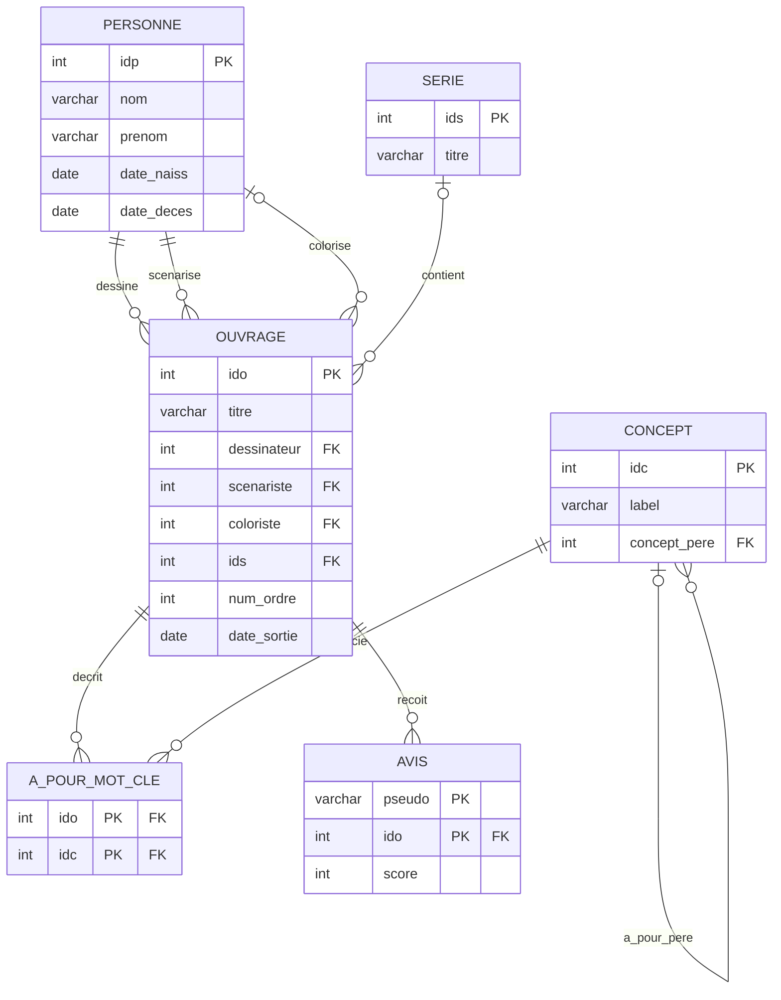
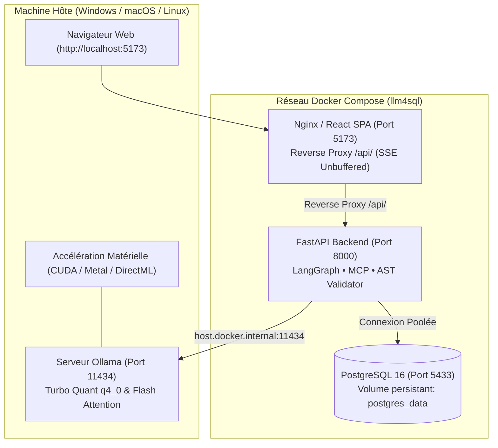

# LLM4SQL - Spécifications Techniques & Fonctionnelles d'Architecture

Ce document spécifie les exigences d'ingénierie, la topologie fonctionnelle, le modèle conceptuel de données et les règles de gouvernance de la plateforme **LLM4SQL**.

---

## 1. Objectifs & Cadre Fonctionnel

La plateforme résout la complexité d'interrogation des bases de données relationnelles en entreprise en fournissant une interface de traduction Langage Naturel ➔ SQL opérant en environnement hermétique local (*air-gapped*).

### 1.1 Exigences Fondamentales :
- **Souveraineté des Données** : Exécution exclusive sur l'infrastructure de l'organisation sans transmission externe vers des API SaaS tierces.
- **Auto-Correction Récursive (Self-Healing)** : Résolution autonome des erreurs de syntaxe ou de schéma via boucle de rétroaction agentique (LangGraph / MCP).
- **Contrôle & Validation Déterministe** : Séparation stricte entre le moteur d'inférence non-déterministe (LLM) et la validation syntaxique/sécurité déterministe (AST SQLGlot, contraintes transactionnelles `read-only`).

---

## 2. Découpage Fonctionnel des Modules

L'interface de travail est structurée en deux modes principaux et quatre modules synchronisés :

```
+---------------------------------------------------------------------------------------------------------+
|                                        MODE 1 : CHAT & WORKSPACE                                        |
|  +---------------------------+---------------------------------+-------------------------------------+  |
|  |     1. LABORATOIRE        |        2. ASSISTANT SQL         |          3. EXPLORATEUR             |  |
|  |        (Sandbox)          |             (Chat)              |            DE DONNÉES               |  |
|  +---------------------------+---------------------------------+-------------------------------------+  |
+---------------------------------------------------------------------------------------------------------+
|                                        MODE 2 : QUALITÉ & ÉVALUATION                                    |
|  +---------------------------------------------------------------------------------------------------+  |
|  |                    4. BANC DE TEST & BENCHMARK D'ÉVALUATION AUTOMATISÉ                            |  |
|  +---------------------------------------------------------------------------------------------------+  |
+---------------------------------------------------------------------------------------------------------+
```

### 2.1 Module 1 : Laboratoire SQL & Bac à Sable DDL (Sandbox)
Le module Sandbox permet d'isoler l'expérimentation de schémas personnalisés :
- **Édition DDL & DML** : Saisie et exécution d'instructions `CREATE TABLE` et `INSERT INTO` dirigées vers le schéma isolé `user_sandbox`.
- **Modélisation Graphique Déterministe** :
  - **Vue Cartes Dynamiques** : Analyse structurelle des contraintes (`PRIMARY KEY`, `FOREIGN KEY`) et mise en évidence des dépendances relationnelles.
  - **Diagramme ER (Mermaid.js)** : Génération instantanée (<1ms) via parser syntaxique AST Python sans dépendance LLM.
    - **Thèmes Haute Lisibilité** : Mode **Papier (Clair) 📄** style ingénierie/Workbench (fond blanc millimétré, bordures noires nettes) et mode **Sombre 🖤**.
    - **Types Universels Compacts** : Normalisation déterministe (`varchar`, `int`, `decimal`, `timestamp`, `bool`) éliminant les chaînes verbeuses.
    - **Mode Plein Écran Immersif & Zoom Centré** : Navigation à échelle adaptative (100%, 135%, +/-) avec centrage vectoriel sans dérive.
- **Restauration** : Réinitialisation instantanée vers le schéma de référence (`public.ouvrage`).

### 2.2 Module 2 : Moteur Agentique & Dialogue (Assistant SQL)
- **Traitement Asynchrone & Télémétrie** : Réception de la requête utilisateur et diffusion en continu (*Server-Sent Events - SSE*) des étapes de décision :
  1. Exploration sélective de schéma (`mcp_get_schema`).
  2. Recherche sémantique de valeurs réelles (`mcp_search_value`).
  3. Validation à blanc sans effet de bord (`mcp_dry_run_query`).
  4. Auto-correction itérative en cas d'erreur PostgreSQL.
- **Transparence de Raisonnement (XAI)** : Streaming jeton par jeton de la réflexion interne du modèle (`<think>`) dans un accordéon rétractable.

### 2.3 Module 3 : Exploration & Restitution Analytique
- **Grille Tabulaire (`DataTable`)** : Navigation paginée, filtrage multi-colonnes, tri déterministe et export de données CSV au format UTF-8 BOM (compatibilité tableurs d'entreprise).
- **Restitution Graphique (`DataVisualization`)** : Tracé dynamique (BarChart, LineChart, PieChart) avec détection automatique des axes dimensionnels et métriques.

### 2.4 Module 4 : Banc de Test & Benchmark d'Évaluation Automatisé
Le module Benchmark (`BenchmarkPanel` & `eval_service.py`) assure l'assurance qualité continue du système Text-to-SQL :
- **Mesure d'Execution Accuracy Multi-Axes** : Exécution comparée en miroir de la requête SQL de vérité terrain (*Ground Truth*) et de la requête générée par l'agent sur PostgreSQL réel.
- **Normalisation Sémantique des Absences (`FALLBACK_NULL_STRINGS`)** : Équivalence automatique entre valeurs `NULL`, `None`, chaînes vides et libellés textuels (`'Pas de série'`, `'N/A'`, `'Inconnu'`) pour éviter tout faux négatif heuristique.
- **Soft-Matching par Jetons Distincts** : Validation des requêtes multi-colonnes ou concaténées via l'algorithme `_find_distinct_token_matching` sans imposer un formatage de colonne arbitraire.
- **Télémétrie Agentique LangGraph** : Capture détaillée et inspection pour chaque cas de test des étapes de réflexion (`<think>`), des appels d'outils MCP, des temps d'inférence et des boucles d'auto-correction (Self-Healing).
- **Gestionnaire de Jeux de Données (CRUD)** : Édition, ajout, suppression et réinitialisation du dataset canonique de 18 cas pratiques (`eval_dataset.json`).


---

## 3. Modèle de Données Canonique : "BD Ouvrages"

Le schéma relationnel de référence modélise une bibliothèque éditoriale structurée en **6 relations** :



### 3.1 Dictionnaire des Relations
1. **`personne`** : Auteurs, dessinateurs, scénaristes et coloristes.
2. **`serie`** : Collections et séries d'œuvres éditoriales.
3. **`ouvrage`** : Entité centrale représentant chaque album publié (relations clés étrangères multiples vers `personne` et `serie`).
4. **`concept`** : Ontologie thématique hiérarchique avec auto-référence (`concept_pere`).
5. **`a_pour_mot_cle`** : Table de jonction N:M associant les ouvrages aux concepts.
6. **`avis`** : Évaluations quantitatives associées aux ouvrages.

---

## 4. Sécurité & Gouvernance (Defense in Depth)

### 4.1 Ségrégation des Privilèges & Validation Syntaxique
- **Validation AST Stricte (SQLGlot)** : Toute commande SQL générée fait l'objet d'un parsing syntaxique en arbre AST. Toute opération non-idempotente ou mutatrice (`DROP`, `DELETE`, `UPDATE`, `INSERT`, `ALTER`, `GRANT`, `REVOKE`) est immédiatement rejetée avec levée d'exception de sécurité.
- **Isolation de Connexion** : Les requêtes analytiques sont exécutées via des curseurs transactionnels en mode `readonly=True` au niveau du pilote PostgreSQL.
- **Protection XSS** : Assainissement systématique des rendus Mermaid et données textuelles via `DOMPurify`.

### 4.2 Optimisation du Contexte & Cache Sémantique
- **Cache Sémantique Vectoriel** : Mise en cache LRU en mémoire des requêtes passées calculée par similarité cosinus (Ollama embeddings) avec fallback textuel de Jaccard (temps de réponse 0ms sur requêtes récurrentes).
- **Bypass Dynamique** : Capacité de forcer le ré-entraînement de l'agent sans interruption de service.
- **Asynchronisme & Gestion de Pool** : Découplage de la boucle événementielle FastAPI (`asyncio.to_thread`) et mutualisation des connexions PostgreSQL (`psycopg2.pool.ThreadedConnectionPool`).

---

## 5. Topologie de Déploiement Conteneurisé

La plateforme applique une topologie hybride standardisée :



### 5.1 Spécifications Opérationnelles :
1. **Zéro Configuration Hôte** : Les conteneurs encapsulent l'ensemble des runtimes (Python 3.12, `uv`, Node 22, Nginx, PostgreSQL 16).
2. **Performance GPU Préservée** : Le moteur d'inférence s'exécute directement sur l'OS hôte, évitant la latence de virtualisation WSL2/Docker GPU.
3. **Cycle de Vie Automatisé** : Détection et application automatique des variables d'accélération d'Ollama (`q4_0`, `Flash Attention`, écoute sur `0.0.0.0:11434`) avec redémarrage transparent si nécessaire.
