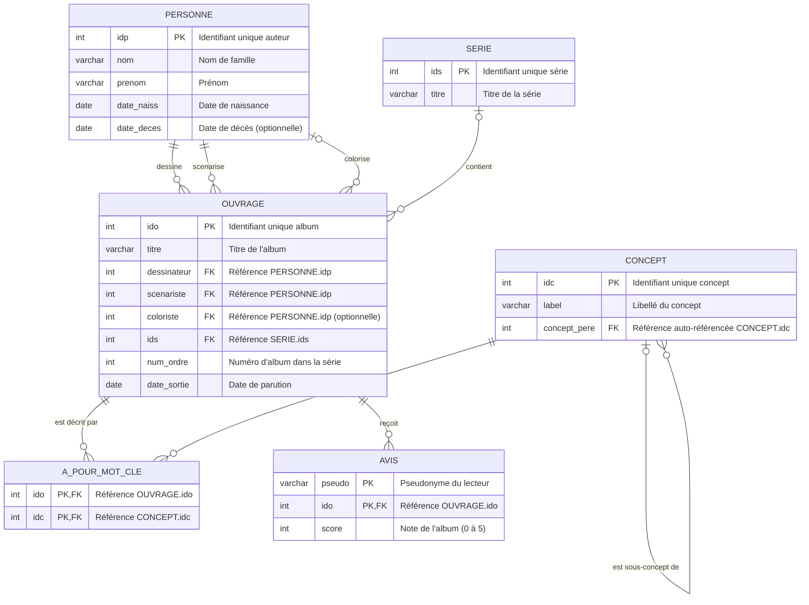

# LLM4SQL - Spécifications Fonctionnelles & Walkthrough Applicatif 📘

Ce document constitue le cahier des charges, la spécification d'architecture fonctionnelle et le manuel de référence du modèle de données métier du projet **LLM4SQL**.

---

## 1. Contexte, Problématique et Objectifs

L'interrogation de bases de données relationnelles complexes en SQL reste une barrière pour de nombreux utilisateurs métiers ou analystes. Les solutions basées sur des modèles d'Intelligence Artificielle hébergés dans le cloud (SaaS) résolvent ce problème mais introduisent des risques majeurs :
- **Fuite de données et métadonnées** : exposition des schémas de table, des relations métiers et des données confidentielles à des tiers.
- **Dépendance et coûts** : latences variables, instabilité d'API et coûts d'infrastructure récurrents.

**LLM4SQL** apporte une réponse à ces défis en combinant la puissance de l'IA générative et de l'orchestration locale :
- **Confidentialité absolue** : L'intégralité du traitement (modèle de langage local via Ollama, base PostgreSQL et application web) s'exécute localement et sans connexion externe.
- **Fiabilité opérationnelle** : Un mécanisme d'auto-correction (*Self-Healing*) capture et résout de manière autonome les erreurs de syntaxe SQL avant affichage.
- **Visualisation dynamique** : Un bac à sable (Sandbox) permet de tester et visualiser graphiquement des schémas SQL à la volée.

---

## 2. Walkthrough Fonctionnel & Parcours Utilisateur

L'interface de l'application est découpée en trois zones majeures agencées en grille plein écran asymétrique :

```
+-------------------+-----------------------------+-------------------------------+
|                   |                             |                               |
|  1. LABORATOIRE   |     2. ASSISTANT SQL        |      3. EXPLORATEUR           |
|      (Sandbox)    |          (Chat)             |         DE DONNÉES            |
|                   |                             |                               |
+-------------------+-----------------------------+-------------------------------+
```

### 2.1 Zone 1 : Le Laboratoire SQL (Sandbox)
La Sandbox permet de tester des requêtes sur un schéma temporaire isolé.
- **Onglet Structure (DDL)** : Champ de texte libre permettant de saisir du code SQL de structure (`CREATE TABLE`).
- **Onglet Données (DML)** : Permet de saisir des instructions d'insertion de données de test (`INSERT INTO`).
- **Onglet Visuel (Double mode)** :
  - **Vue Cartes 🎴 (Modélisation Client)** : Analyse instantanément le code DDL pour dessiner des fiches pour chaque table, listant ses colonnes et types SQL associés avec des badges de contraintes (`🔑 PK` pour clé primaire, `🔗 FK` pour clé étrangère). Cliquer sur une table met en surbrillance ses dépendances.
  - **Vue Diagramme ER 📊 (Mermaid)** : Rendu graphique stable Mermaid.js généré instantanément (<1ms) de façon déterministe grâce au parser Python du backend.
- **Actions** : 
  - **Initialiser la Sandbox** : Réinitialise et peuple le schéma isolé `user_sandbox` sur PostgreSQL.
  - **Réinitialiser par défaut** : Restaure le schéma "BD Ouvrages" par défaut dans le schéma `public`.

### 2.2 Zone 2 : L'Assistant SQL (Chat-like)
Cette zone est dédiée à la formulation des requêtes en langage naturel et au suivi de la réflexion de l'IA.
- **Champ de saisie** : L'utilisateur formule sa question (ex : *"Quels albums ont une note supérieure à 4 ?"*).
- **Suivi d'exécution en direct** : Une checklist s'anime en temps réel, montrant les étapes parcourues par l'agent (ex: Sélection des tables -> Génération SQL -> Validation syntaxique -> Exécution).
- **Streaming de la réflexion** : Un accordéon pliable affiche en temps réel la pensée brute de l'IA (`<think>`) pendant la phase de réflexion, garantissant une observabilité complète.
- **Restitution de la réponse** :
  - **Bloc de code SQL** : Affiche la requête SQL exécutée avec un bouton "Copier" rapide.
  - **Badge d'auto-correction (Self-Healing)** : Indique si la requête a dû être corrigée et en combien d'itérations.
  - **Console de logs SSE** : Un volet rétractable en bas de l'écran diffuse en temps réel les logs d'activité du backend.

### 2.3 Zone 3 : L'Explorateur de Données
Cette zone présente le résultat brut extrait de la base sous deux formes :
- **Mode Tableau 📋** : Grille de données paginée et triable, munie d'une barre de recherche locale. Elle intègre un bouton d'export CSV encodé en UTF-8 BOM, garantissant une ouverture sans altération de caractères dans Excel.
- **Mode Graphique 📈** : Construit des tracés (Histogrammes, Courbes, Aires) avec détection et adaptation dynamique des axes de coordonnées (axe X pour les dimensions textuelles/temporelles, axe Y pour les mesures numériques).

---

## 3. Modèle Conceptuel de Données : "BD Ouvrages"

L'application est pré-configurée avec une base de données de test simulant une bibliothèque de bandes dessinées (albums, auteurs, séries et critiques). Elle comprend **6 tables** interconnectées :



### 3.1 Description Métier des Tables
1. **`personne`** : Contient les auteurs de BD. Un auteur peut cumuler plusieurs rôles (scénariste pour une œuvre, dessinateur ou coloriste pour une autre).
2. **`serie`** : Regroupe des albums thématiques (ex : *Astérix*, *Lanfeust de Troy*).
3. **`ouvrage`** : Table pivot représentant un album physique de BD. Elle lie l'œuvre à sa série de rattachement, ses auteurs (trois clés étrangères référençant `personne`), son ordre d'apparition et sa date de parution.
4. **`concept`** : Représente une ontologie hiérarchique de thèmes (ex : `Science-Fiction` est parent de `Space-Opera`). Le champ `concept_pere` est une relation auto-référencée.
5. **`a_pour_mot_cle`** : Table de liaison (relation Plusieurs-à-Plusieurs) associant chaque album à des concepts sémantiques clés.
6. **`avis`** : Enregistre les scores de satisfaction saisis par des lecteurs identifiés par leur pseudonyme.

---

## 4. Principes Transverses d'Architecture & Sécurité

Pour maintenir une sécurité et une robustesse de niveau production, plusieurs contraintes et mécanismes transverses sont appliqués :

### 4.1 Sécurité des Données (Defense in Depth)
- **Validation AST (SQLGlot)** : Toute requête SQL générée par l'IA ou soumise par un client est convertie en arbre syntaxique (AST) et analysée par `SQLGlot`. Les commandes autres que `SELECT` (comme `DROP`, `DELETE`, `UPDATE`, `INSERT`, `ALTER`) sont immédiatement interceptées et bloquées.
- **Lecture Seule au Niveau Pilote** : Les connexions de requêtes de l'assistant sont instanciées avec le flag `readonly = True` au niveau du pilote de base de données.
- **Sandbox Isolé** : L'initialisation du laboratoire SQL s'effectue dans un schéma PostgreSQL dédié (`user_sandbox`) isolé du schéma principal, limitant la portée de toute commande DDL.

### 4.2 Optimisation du Flux de Requête (Performance)
- **Exploration de Schéma Dynamique (MCP & Tool Calling)** : Le modèle interroge de lui-même et de manière sélective les outils du serveur MCP (ex: `mcp_get_schema`) pour charger dynamiquement le schéma des tables nécessaires au traitement de la question, évitant de saturer inutilement sa jauge de contexte. Pour ce faire, l'utilisation d'un modèle capable d'appels d'outils (*Tool Calling*) est indispensable.
- **Cache Sémantique Double Couche** :
  - **Embedding Cosinus** : Calcule la proximité de la question avec les questions passées en base vectorielle locale via l'API Ollama.
  - **Distance de Jaccard** : En cas de latence sur les embeddings, un calcul sémantique basé sur l'intersection des mots-clés est appliqué en repli. Une question similaire renvoie instantanément le résultat mis en cache (0ms).
- **Asynchronisme Non Bloquant** : Toutes les requêtes d'accès au dictionnaire de données de PostgreSQL sont déportées dans un pool de threads d'arrière-plan (`asyncio.to_thread`) pour garantir que la boucle d'événements principale du serveur FastAPI ne subisse aucune latence.
