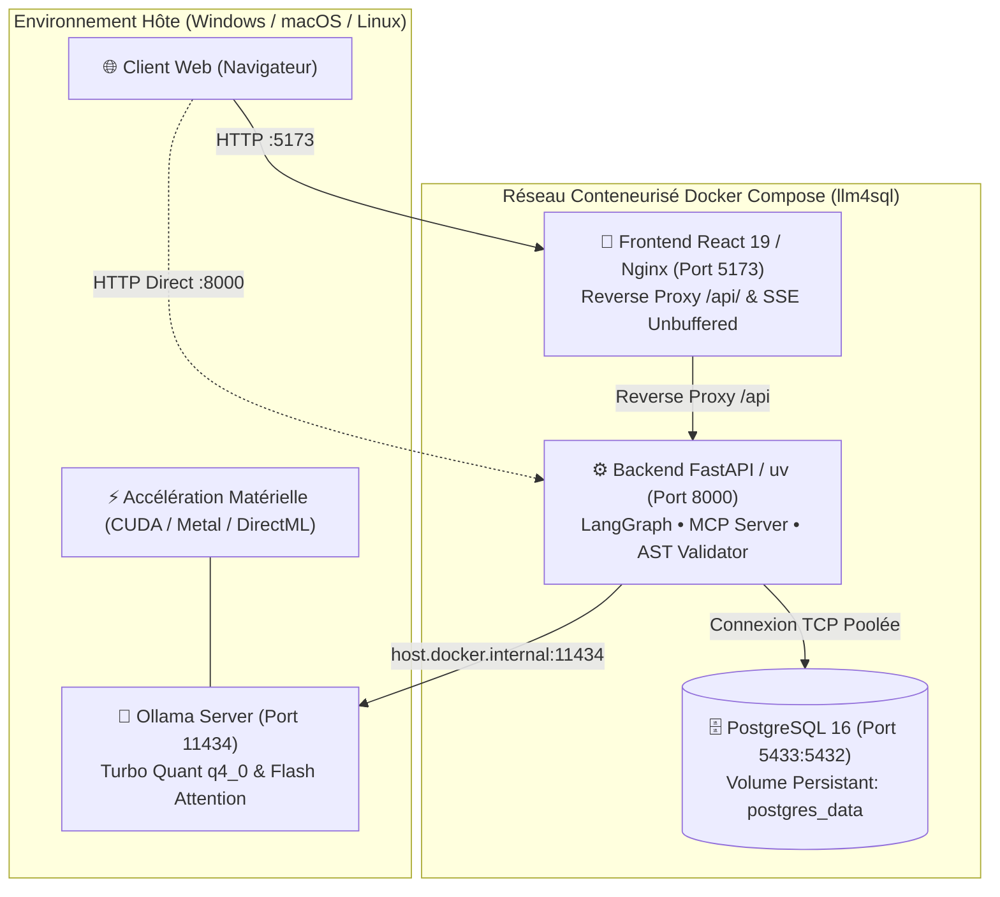

# LLM4SQL - Plateforme Agentique Locale de Traduction Text-to-SQL

[](https://fastapi.tiangolo.com)
[](https://langchain-ai.github.io/langgraph/)
[](https://react.dev/)
[](https://www.docker.com/)
[](https://opensource.org/licenses/MIT)

**LLM4SQL** est une plateforme d'ingénierie décisionnelle 100% locale, privée et conteneurisée. Elle traduit des requêtes en langage naturel en requêtes SQL valides via une architecture agentique récursive (LangGraph / Ollama), applique une validation de sécurité déterministe (AST SQLGlot), et restitue les données analytiques via une interface interactive (tableaux dynamiques, graphiques adaptatifs et modélisation ER).

---

## 1. Vue d'Ensemble & Capacités Système

- **Confidentialité Totale (Air-Gapped Ready)** : Aucune donnée, métadonnée ou schéma relationnel ne transite en dehors de la machine locale.
- **Orchestration Agentique & Auto-Correction (Self-Healing)** : Détection et correction autonome des erreurs d'exécution SQL via LangGraph et le protocole MCP (*Model Context Protocol*).
- **Validation Déterministe de Sécurité** : Interception AST par SQLGlot interdisant strictement toute mutation de données (`INSERT`, `UPDATE`, `DELETE`, `DROP`, `ALTER`) sur les flux d'interrogation.
- **Visualiseur de Schéma & Sandbox Découplé** : Génération instantanée de diagrammes entité-association (Mermaid.js) et environnement de test isolé (`user_sandbox`).
- **Benchmark d'Évaluation Automatisé** : Mesure de l'*Execution Accuracy* sur dataset canonique avec soft-matching sémantique et télémétrie par étape.

---

## 2. Topologie & Architecture Système

L'application utilise un modèle d'architecture hybride optimisé : la pile applicative (**PostgreSQL 16, FastAPI, React/Nginx**) s'exécute dans un réseau Docker isolé, tandis que le moteur d'inférence **Ollama** s'exécute directement sur l'hôte pour garantir un accès natif aux accélérateurs matériels (NVIDIA CUDA, Apple Silicon Metal, DirectML).



---

## 3. Prérequis Système

| Composant | Version Minimale | Rôle |
| :--- | :--- | :--- |
| **Docker / Docker Desktop** | v24.0+ (Compose v2.20+) | Conteneurisation de PostgreSQL, FastAPI et React. |
| **Ollama** | v0.5.0+ | Moteur d'inférence LLM local sur l'hôte physique. |
| **Modèle LLM recommandé** | `qwen3.5:4b` ou `qwen3.5:9b` | Inférence agentique avec support natif du *Tool Calling*. |

---

## 4. Déploiement & Cycle de Vie

### 4.1 Méthode 1 : Démarrage Automatisé 1-Clic (Recommandé)

Les scripts d'orchestration racine vérifient l'environnement hôte, appliquent les variables d'optimisation GPU (`q4_0 KV Cache`, `Flash Attention`, écoute sur `0.0.0.0:11434`), redémarrent Ollama si nécessaire, et démarrent les conteneurs dans l'ordre strict de dépendance.

- **Windows (Double-clic)** :
  Exécuter `start.bat` à la racine du projet.
- **Windows (PowerShell)** :
  ```powershell
  .\start.ps1
  ```
- **Linux / macOS (Bash)** :
  ```bash
  chmod +x start.sh stop.sh
  ./start.sh
  ```

L'application s'ouvre automatiquement sur **[http://localhost:5173](http://localhost:5173)**.

### 4.2 Méthode 2 : Déploiement Standard Docker Compose / NPM

```bash
# Lancement de la stack conteneurisée
docker compose up --build -d

# Alternative via NPM
npm start
```

### 4.3 Arrêt des Services

```bash
# Windows
.\stop.ps1
# ou double-clic sur stop.bat

# Linux / macOS
./stop.sh

# Commande standard
docker compose down
```

---

## 5. Référence de Configuration (`.env`)

Les variables d'environnement sont déclarées dans `.env` à la racine ou injectées par l'orchestrateur :

| Variable | Valeur par défaut | Description |
| :--- | :--- | :--- |
| `DB_HOST` | `127.0.0.1` *(ou `db` dans Docker)* | Hôte du serveur PostgreSQL. |
| `DB_PORT` | `5433` *(ou `5432` dans Docker)* | Port TCP PostgreSQL. |
| `DB_NAME` | `llm4sql_db` | Nom de la base de données relationnelle. |
| `DB_USER` | `llm4sql_user` | Identifiant de connexion. |
| `DB_PASSWORD` | `llm4sql_password` | Mot de passe de connexion. |
| `OLLAMA_BASE_URL` | `http://localhost:11434` *(ou `host.docker.internal:11434`)* | URL de l'API Ollama. |
| `OLLAMA_MODEL` | `qwen3.5:4b` | Modèle d'inférence par défaut. |
| `ENV` | `production` / `development` | Mode d'exécution applicatif. |

---

## 6. Structure de la Documentation Technique (Standard Diátaxis)

La documentation de **LLM4SQL** est organisée selon le standard architectural **Diátaxis**, optimisé pour les développeurs et l'ingestion par les agents IA :

| Quadrant Diátaxis | Rôle & Contenu | Fichiers de Référence |
| :--- | :--- | :--- |
| **🚀 Tutorials (Prise en main)** | Démarrage rapide 1-clic, prérequis et découverte du flux d'inférence en moins de 3 minutes. | [README.md (Sec. 4)](./README.md#4-d%C3%A9ploiement--cycle-de-vie), [start_backend.ps1](./backend/start_backend.ps1) |
| **🛠️ How-To Guides (Guides pratiques)** | Procédures pas-à-pas : configuration de modèle Ollama, création de schéma isolé Sandbox, exécution du benchmark. | [backend/README.md](./backend/README.md), [frontend/README.md](./frontend/README.md) |
| **📖 Reference (Spécifications & Faits)** | Modèle relationnel BD Ouvrages, catalogue des outils MCP, variables `.env`, endpoints REST OpenAPI. | [Docs.md](./Docs.md), [backend/README.md (Sec. MCP & Endpoints)](./backend/README.md) |
| **💡 Explanation (Architecture & Choix)** | Graphe de décision LangGraph ReAct, Défense en profondeur AST, registre des décisions d'architecture (ADRs). | [Docs.md (Sec. 4-5)](./Docs.md) |


---

## 7. Assurance Qualité & Tests

Exécution de la suite complète de vérification :

```bash
# Tests Backend (Pytest)
cd backend && uv run pytest

# Build de Validation Frontend (Vite / TypeScript Strict)
cd frontend && npm run build

# Validation de Syntaxe Docker Compose
docker compose config
```
