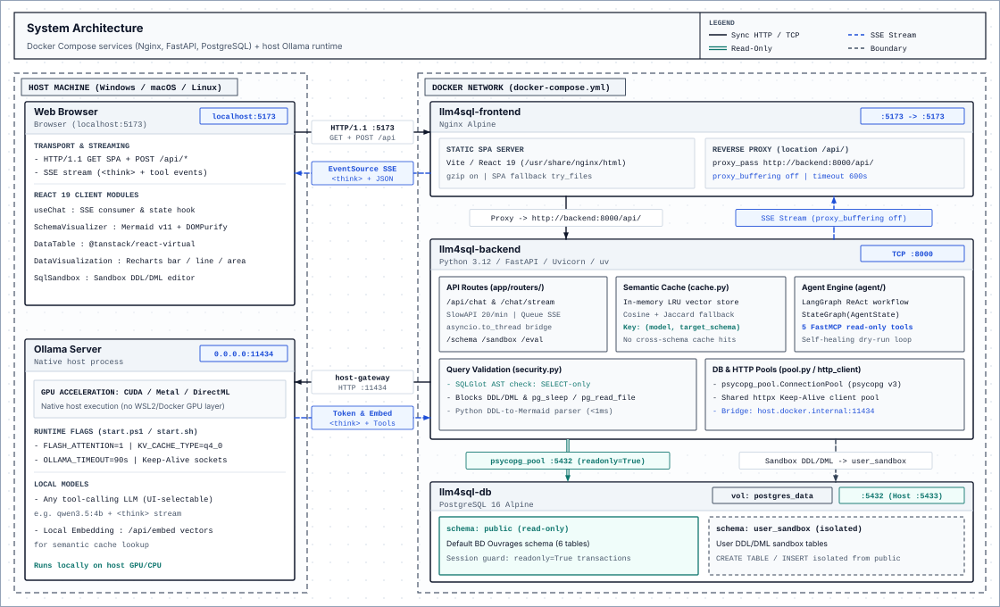

# LLM4SQL

[](https://fastapi.tiangolo.com)
[](https://langchain-ai.github.io/langgraph/)
[](https://react.dev/)
[](https://www.docker.com/)
[](./LICENSE)

Natural language to SQL running locally with any tool-calling Ollama model, LangGraph, FastAPI, PostgreSQL 16, and React 19. Inspects database schemas via read-only MCP tools, dry-runs candidate queries with `EXPLAIN`, and blocks non-`SELECT` statements via SQLGlot.

---

## Quickstart

### Prerequisites
- [Docker & Docker Compose](https://www.docker.com/) (v24.0+)
- [Ollama](https://ollama.com/) installed on the host machine
- Any tool-calling model pulled in Ollama (selectable live in the UI; e.g., `ollama pull qwen3.5:4b`)

### Option 1: Unified Launcher (Recommended)
Starts or restarts host Ollama with `OLLAMA_HOST=0.0.0.0:11434`, `OLLAMA_KV_CACHE_TYPE=q4_0`, and `OLLAMA_FLASH_ATTENTION=1`, builds and starts the Docker stack, and verifies container-to-host Ollama connectivity:

- **Windows (PowerShell / CMD)**:
  ```powershell
  git clone https://github.com/Metzo-GH/llm4sql.git
  cd llm4sql
  Copy-Item .env.example .env
  .\start.ps1
  ```
  *(Or run `start.bat`. Stop with `.\stop.ps1`.)*

- **Linux / macOS**:
  ```bash
  git clone https://github.com/Metzo-GH/llm4sql.git
  cd llm4sql
  cp .env.example .env && chmod +x start.sh stop.sh
  ./start.sh
  ```
  *(Stop with `./stop.sh`.)*

### Option 2: Manual Docker Compose
`docker compose` manages only the 3 containers (`db`, `backend`, `frontend`) and cannot start host processes. Host Ollama must already be running with `OLLAMA_HOST=0.0.0.0:11434` so containers can reach it via `host.docker.internal:11434` (containers cannot connect to `127.0.0.1:11434` on the host):

```bash
cp .env.example .env
OLLAMA_HOST=0.0.0.0:11434 OLLAMA_KV_CACHE_TYPE=q4_0 OLLAMA_FLASH_ATTENTION=1 ollama serve &
docker compose up --build -d
```
Open **[http://localhost:5173](http://localhost:5173)**. Stop containers with `docker compose down`.

---

## Demos

- **Chat & `<think>` token streaming**:

https://github.com/Metzo-GH/llm4sql/releases/download/v1.0.0/Chat.mp4

- **Automated SQL benchmark runner**:

https://github.com/Metzo-GH/llm4sql/releases/download/v1.0.0/benchmark.mp4

---

## Architecture

- **Docker Compose network**: PostgreSQL 16 (`public` read-only + `user_sandbox`), FastAPI/Uvicorn backend, and Nginx serving the React 19 SPA with `proxy_buffering off` for SSE.
- **Host machine**: Native Ollama process (`0.0.0.0:11434`) with direct GPU access (`CUDA`, `Metal`, `DirectML`).



---

## Benchmark

Evaluated with `qwen3.5:4b` on 18 reference SQL test cases (`Easy`: 6/6, `Medium`: 5/5, `Hard`: 4/4, `Advanced`: 3/3) covering single-table filters, multi-table joins, aggregates, and CTEs/subqueries (any installed Ollama model can be benchmarked from the UI):

| Metric | Phase 2 Baseline | Current Pipeline (ReAct + Token Matching) | Delta |
| :--- | :---: | :---: | :---: |
| **Execution Accuracy** | 61.1% (11/18) | **100.0%** (18/18) | **+38.9%** |
| **Syntax & Join Error Rate** | 38.9% (7/18) | **0.0%** (0/18) | **-38.9%** |
| **Total Benchmark Time** | 1,099.8s | **416.0s** | **2.6x faster** |
| **Average Latency / Query** | ~61.1s | **~23.1s** | **-38.0s** |

---

## Configuration (`.env`)

| Variable | Default | Description |
| :--- | :--- | :--- |
| `DB_HOST` | `127.0.0.1` (`db` in Docker) | PostgreSQL host |
| `DB_PORT` | `5433` (`5432` in Docker) | PostgreSQL port |
| `DB_NAME` | `llm4sql_db` | Database name |
| `DB_USER` | `llm4sql_user` | Database user |
| `DB_PASSWORD` | `llm4sql_password` | Database password |
| `OLLAMA_BASE_URL` | `http://localhost:11434` | Ollama HTTP endpoint |
| `OLLAMA_MODEL` | `qwen3.5:4b` | Fallback model when none is passed (the UI switches installed models dynamically) |
| `OLLAMA_TIMEOUT` | `90.0` | Ollama request timeout in seconds |
| `ENV` | `development` / `production` | Runtime environment |

---

## Testing

```bash
# Backend test suite (87 unit and integration tests)
cd backend && uv run pytest

# Frontend type check and production bundle
cd frontend && npm run build

# Validate Docker Compose file
docker compose config
```

---

## Documentation

- [ARCHITECTURE.md](./ARCHITECTURE.md) — System topology, SSE request sequence, repository layout, and ADR index.
- [backend/README.md](./backend/README.md) — FastAPI setup, LangGraph execution flow, MCP tools, and API routes.
- [frontend/README.md](./frontend/README.md) — React 19 client setup, hooks, parsers, and UI components.
- [Docs.md](./Docs.md) — Workspace panel guide, default *BD Ouvrages* schema, and security rules.
- [docs/adr/](./docs/adr/) — Architecture Decision Records.
- [CHANGELOG.md](./CHANGELOG.md) — Release history.
- [LICENSE](./LICENSE) — MIT License.
