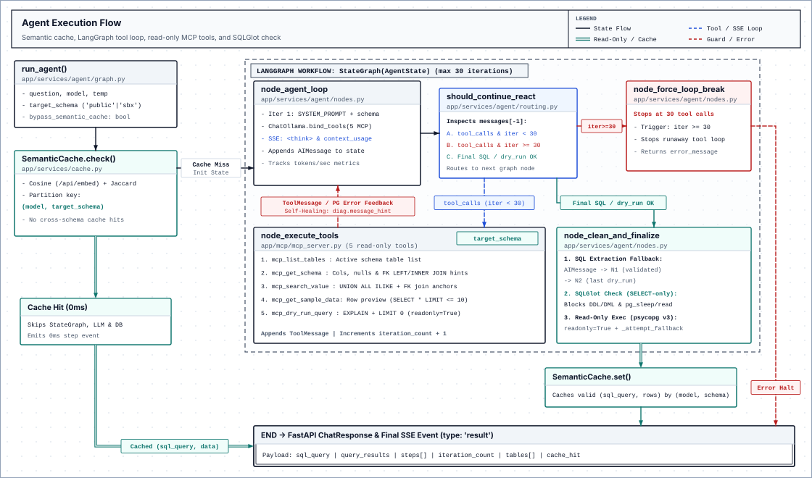

# Backend

FastAPI service that runs the LangGraph Text-to-SQL agent, exposes read-only PostgreSQL MCP tools, and manages the evaluation benchmark.

---

## Local Setup

### Prerequisites
- Python 3.12+ and [`uv`](https://docs.astral.sh/uv/)
- Docker (for PostgreSQL 16)
- [Ollama](https://ollama.com/) with any capable tool-calling model (switched dynamically per request; e.g., `ollama pull qwen3.5:4b` recommended)

### Start the Server
```powershell
# Windows (starts PostgreSQL container, syncs uv env, sets Ollama flags, runs Uvicorn on :8000)
.\start_backend.ps1
```
```bash
# Linux / macOS
chmod +x start_backend.sh && ./start_backend.sh

# Manual run (when PostgreSQL and Ollama are already running)
uv sync
uv run uvicorn app.main:app --reload --port 8000
```

### Ollama Runtime Flags
`start_backend.ps1` and `start_backend.sh` set these environment variables for Ollama:
- `OLLAMA_KV_CACHE_TYPE="q4_0"` — 4-bit KV cache quantization to lower VRAM usage.
- `OLLAMA_FLASH_ATTENTION="1"` — enables Flash Attention on supported GPUs.
- `OLLAMA_KEEP_ALIVE="-1"` — keeps the active model loaded in memory.
- `OLLAMA_NUM_PARALLEL="1"` — single inference slot to reduce memory contention.
- `OLLAMA_HOST="0.0.0.0:11434"` — allows Docker containers to reach host Ollama.

---

## Agent Execution Flow



### Read-Only MCP Tools (`app/mcp/mcp_server.py`)

| Tool | Arguments | Behavior |
| :--- | :--- | :--- |
| `mcp_list_tables` | `(target_schema="public")` | Lists tables in `public` or `user_sandbox`. |
| `mcp_get_schema` | `(table_names, target_schema="public")` | Returns columns, nullability, PKs, and FK `LEFT JOIN` vs `INNER JOIN` hints for comma-separated tables. |
| `mcp_search_value` | `(search_term, table_filter="", target_schema="public")` | Runs case-insensitive `UNION ALL` `ILIKE` searches (up to 15 hits) across text columns and returns FK join hints. |
| `mcp_get_sample_data` | `(table_name, limit=3, target_schema="public")` | Returns `1..10` sample rows (`SELECT * LIMIT n`). |
| `mcp_dry_run_query` | `(sql_query, target_schema="public")` | Checks SQL via `sqlglot`, runs `EXPLAIN` + `SELECT ... LIMIT 0` under `readonly=True`, and returns plan columns or PostgreSQL `diag.message_primary` / `diag.message_hint`. |

### Graph Routing, Self-Healing & Fallbacks (`app/services/agent/`)
- **`SemanticCache` (`app/services/cache.py`)**: 100-entry LRU cache keyed by `(model, target_schema)`. Returns cached `(sql_query, rows)` in `0ms` when Ollama embedding cosine similarity is `>= 0.90` (falls back to Jaccard token overlap if embeddings fail).
- **`should_continue_react` (`routing.py`)**: Routes to `node_force_loop_break` if `iteration_count >= 30`. Routes straight to `node_clean_and_finalize` when the latest `ToolMessage` is a passing `mcp_dry_run_query` (`success: true`) with no pending tool calls, skipping an extra LLM round-trip.
- **Self-healing**: Failed dry-runs return PostgreSQL's `diag.message_primary` and `diag.message_hint` inside a `ToolMessage` so `node_agent_loop` can fix column names, joins, or `GROUP BY` clauses on the next iteration.
- **`node_clean_and_finalize` (`nodes.py`)**: Extracts SQL from the final `AIMessage`, falling back to **N1** (`get_last_validated_query`, last passing dry-run) and **N2** (`get_last_dry_run_query`). `sqlglot` rejects any non-`SELECT` AST before execution on `psycopg_pool.ConnectionPool` (`readonly=True`), with `_attempt_fallback` if primary execution errors.

---

## API Endpoints

| Group | Method | Path | Rate Limit | Description |
| :--- | :--- | :--- | :--- | :--- |
| Chat | `POST` | `/api/chat` | `20/minute` | Synchronous agent run returning a `ChatResponse` JSON payload. |
| Chat | `POST` | `/api/chat/stream` | `20/minute` | SSE stream of `<think>` tokens, MCP steps, context usage, and final result (`X-Accel-Buffering: no`). |
| Chat | `POST` | `/api/chat/execute-raw` | `30/minute` | Runs user-edited `SELECT` SQL after `sqlglot` AST validation (`readonly=True`). |
| Sandbox | `POST` | `/api/sandbox/init` | `20/minute` | Resets `user_sandbox`, executes DDL/DML, and clears the schema cache. |
| Sandbox | `POST` | `/api/sandbox/visualize` | `20/minute` | Converts SQL DDL into a Mermaid `erDiagram` in Python (`<1ms`, no LLM). |
| Sandbox | `GET` | `/api/sandbox/schema` | — | Returns active DDL and Mermaid code (`user_sandbox` if populated, else `public`). |
| Schema | `GET` | `/api/schema` | — | Returns cached schema metadata for `public`. |
| Monitoring | `GET` | `/` | — | Root API status probe. |
| Monitoring | `GET` | `/api/health` | — | Docker Compose healthcheck endpoint. |
| Monitoring | `GET` | `/api/ollama/status` | — | Loaded model GPU/CPU VRAM split and context length from Ollama `/api/ps`. |
| Monitoring | `GET` | `/api/ollama/models` | — | Installed local models from Ollama `/api/tags`. |
| Eval | `GET` | `/api/eval/cases` | — | Lists benchmark test cases from `eval_dataset.json`. |
| Eval | `POST` | `/api/eval/cases` | — | Appends a custom benchmark case. |
| Eval | `PUT` | `/api/eval/cases/{case_id}` | — | Updates an existing benchmark case. |
| Eval | `DELETE` | `/api/eval/cases/{case_id}` | — | Deletes a benchmark case. |
| Eval | `POST` | `/api/eval/cases/reset` | — | Restores the 18 default benchmark cases. |
| Eval | `POST` | `/api/eval/run` | `5/minute` | Runs the full benchmark and returns a JSON summary report. |
| Eval | `GET` | `/api/eval/stream` | `5/minute` | Case-by-case SSE progress stream for the benchmark runner. |
| Eval | `POST` | `/api/eval/stop` | — | Stops an active benchmark run (alias `/api/eval/cancel`). |
| Eval | `GET` | `/api/eval/history` | — | Returns recent benchmark run summaries held in memory. |

---

## Project Structure & Tests

```text
backend/
├── app/
│   ├── core/          # config.py, security.py (sqlglot), limiter.py, http_client.py
│   ├── database/      # pool.py (psycopg_pool), queries.py, seed_db.py
│   ├── mcp/           # mcp_server.py (5 read-only FastMCP tools)
│   ├── routers/       # chat.py, sandbox.py, schema.py, eval.py, monitoring.py
│   ├── schemas/       # Pydantic request/response models (chat.py, sandbox.py)
│   └── services/      # agent/ (graph, nodes, routing, prompts, sql_utils), eval/, cache.py
└── tests/             # test_agent, test_api, test_cache, test_eval*, test_mcp*, test_security_r1, ...
```

```bash
# Offline unit tests (no PostgreSQL or Ollama required)
uv run pytest tests/test_eval_modules.py tests/test_cache.py tests/test_pool_cleanup.py -q

# Full suite (requires running PostgreSQL and Ollama)
uv run pytest
```

See [../ARCHITECTURE.md](../ARCHITECTURE.md) for container topology and end-to-end SSE sequence.
