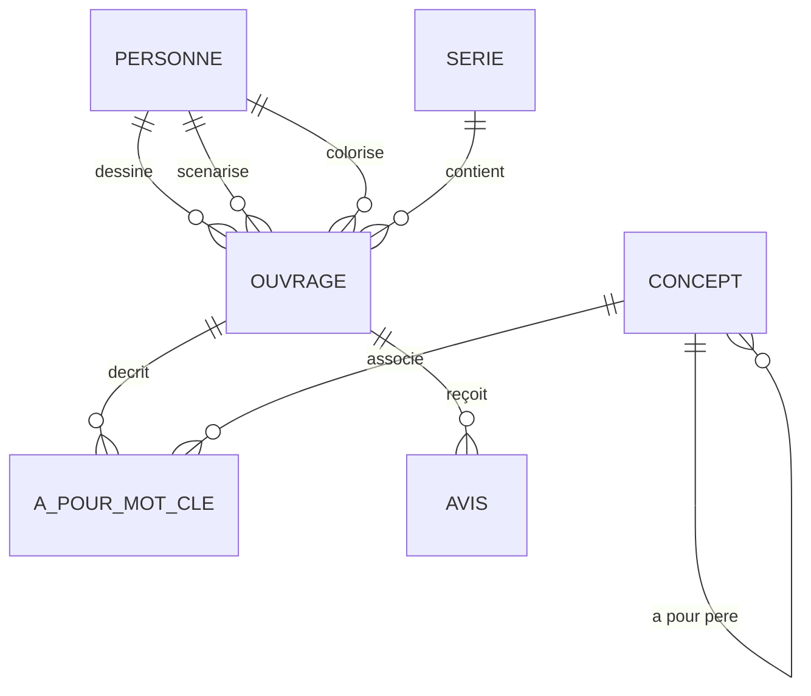

# LLM4SQL - Moteur Backend & Agent SQL Local 🚀

Ce dossier contient le moteur backend souverain de **LLM4SQL**. L'application est conçue pour fonctionner **à 100% en local** sur votre machine. Elle traduit des questions en langage naturel en requêtes SQL valides, les exécute sur une base de données PostgreSQL et utilise un agent intelligent pour s'auto-corriger en cas d'erreur.

---

## 🏗️ Architecture du Backend

Le backend repose sur une stack moderne, rapide et robuste :
1. **Python 3.12+** géré par **`uv`** (gestionnaire de dépendances de nouvelle génération, ultra-rapide).
2. **PostgreSQL v16** fonctionnant dans un conteneur **Docker** pour une flexibilité maximale.
3. **Ollama** avec le modèle **Qwen 3.5 (9B)** comme moteur d'intelligence artificielle locale.
4. **LangGraph** (prochaine phase) pour orchestrer l'agent et sa boucle d'auto-correction (*Self-Healing*).
5. **FastAPI** (prochaine phase) pour exposer l'agent via une API REST rapide et moderne.
6. **Pytest** pour exécuter les tests automatisés unitaires et d'intégration.

---

## ⚡ Démarrage Automatisé & Optimisations (Recommandé) 🛠️

Pour vous simplifier la vie, un script d'automatisation PowerShell a été créé : **[`start_backend.ps1`](file:///c:/Users/Metzo/Documents/projet%20ia/llm4sql/backend/start_backend.ps1)**. 

### Que fait ce script automatiquement pour vous ?
1. **Active le Turbo Quant (KV Cache en 8-bit)** : Configure la variable d'environnement `$env:OLLAMA_KV_CACHE_TYPE = "q8_0"` pour diviser par 2 l'empreinte VRAM du contexte et prévenir les crashs d'Out-of-Memory.
2. **Active Flash Attention** : Force `$env:OLLAMA_FLASH_ATTENTION = "1"` pour accélérer la vitesse de calcul logique.
3. **Configure l'environnement Python** : Ajoute automatiquement le chemin local de `uv` au PATH de votre terminal.
4. **Gère l'infrastructure Docker** : Lance la base de données PostgreSQL sur le port sécurisé `5433`.
5. **Initialise vos données** : Vide et peuple les tables avec le jeu de données "BD Ouvrages" automatiquement.

### Comment l'utiliser ?
Ouvrez PowerShell et lancez simplement :
```powershell
cd "c:\Users\Metzo\Documents\projet ia\llm4sql\backend"
./start_backend.ps1
```
Et voilà ! Tout est prêt et configuré en une seule commande !

---

## 🛠️ Guide d'Installation de la Stack (Manuel)

Si vous préférez exécuter chaque étape manuellement, suivez le guide ci-dessous :

### Étape 1 : Prérequis système
Assurez-vous d'avoir installé sur votre machine :
- **Docker Desktop** : [Télécharger Docker](https://www.docker.com/products/docker-desktop/) (nécessaire pour exécuter la base de données).
- **Ollama** : [Télécharger Ollama](https://ollama.com/) (nécessaire pour faire tourner l'IA localement).

### Étape 2 : Démarrage du modèle local (Ollama)
Ouvrez un terminal Windows (PowerShell) et exécutez la commande suivante pour vous assurer que le modèle Qwen 3.5 9B est installé et prêt :
```bash
ollama run qwen3.5:9b
```
*(Si le modèle n'est pas présent, Ollama le téléchargera automatiquement depuis son registre public).*

### Étape 3 : Installation du gestionnaire `uv`
`uv` est un outil de pointe pour la gestion des paquets Python. Si vous ne l'avez pas, ouvrez PowerShell et lancez :
```powershell
powershell -ExecutionPolicy ByPass -c "irm https://astral.sh/uv/install.ps1 | iex"
```
Par défaut, sous Windows, `uv` s'installe dans `~/.local/bin/`.

### Étape 4 : Initialisation de l'environnement virtuel Python
Positionnez-vous dans le répertoire du backend :
```powershell
cd "c:\Users\Metzo\Documents\projet ia\llm4sql\backend"
```
Puis, créez et configurez l'environnement virtuel :
```powershell
# Créer le dossier .venv et synchroniser les dépendances déclarées
uv sync
```
Les dépendances clés installées incluent :
- `psycopg2-binary` (pilote de connexion PostgreSQL)
- `langgraph`, `langchain-core` et `langchain-ollama` (pour le moteur agentique)
- `fastapi` et `uvicorn` (pour l'API web)
- `mcp` (SDK du protocole Model Context Protocol d'Anthropic)
- `pytest` et `pytest-asyncio` (cadre de tests asynchrones)

---

## 💾 La Base de Données "Ouvrages BD" (Docker PostgreSQL)

### ⚠️ Gestion de conflit de port sous Windows (Pédagogie)
Par défaut, PostgreSQL s'exécute sur le port **`5432`**. Cependant, si vous avez déjà un serveur PostgreSQL installé nativement sur votre système Windows, lancer Docker sur le port `5432` provoquera un conflit d'accès.
Pour résoudre cela :
- Notre configuration Docker expose le port **`5433`** de votre machine hôte vers le port `5432` interne du conteneur.
- Votre service PostgreSQL natif Windows continue de tourner sur le port `5432` sans aucun conflit.
- Notre application se connecte à Docker à l'adresse `127.0.0.1:5433`.

### Démarrage de la base de données
```powershell
docker compose up -d
```
Pour vérifier que le conteneur tourne correctement :
```powershell
docker compose ps
```

---

## 📊 Description du Jeu de Données (Schéma "BD Ouvrages")

La base de données simule une gestion de bandes dessinées (albums, séries, auteurs, concepts et avis lecteurs). Elle est structurée autour de **6 tables** clés :



### Les Tables en détail :
1. **`personne`** : Stocke les auteurs de BD.
2. **`serie`** : Liste les séries d'albums (ex: *Blacksad*, *Trolls de Troy*).
3. **`ouvrage`** : Stocke chaque album/ouvrage individuel de bande dessinée.
4. **`concept`** : Représente des concepts thématiques hiérarchiques (ex: *animal* -> *chien*).
5. **`a_pour_mot_cle`** : Table d'association liant les ouvrages aux concepts.
6. **`avis`** : Recense les critiques et notes des lecteurs.

### Peupler la base de données (Seed)
```powershell
uv run seed_db.py
```

---

## 🧪 Cadre de Tests Automatisés (TDD) 🟢

Pour garantir que notre code reste robuste et qu'aucune régression n'est introduite, nous avons configuré un cadre de tests basé sur **`pytest`** :
1. **Validation unitaire** des syntaxes SQL générées.
2. **Validation d'intégration** avec la base de données PostgreSQL dans Docker.
3. **Tests de sécurité** pour bloquer toute commande SQL malveillante.

### Exécuter les tests :
Depuis le dossier `backend`, lancez la commande suivante :
```powershell
uv run pytest
```
*Le système découvrira et exécutera automatiquement tous les tests présents dans le répertoire.*

---

## 🛡️ Audit de Santé & Sécurité (Health Audit)

Un audit complet a été réalisé et consigné dans **`health_audit.md`** à la racine de la conversation. Les points critiques pris en compte sont :
- **Sécurisation en lecture seule** : Pour la phase 2, nous construisons un serveur MCP avec un décorateur `@read_only` empêchant toute altération de données (`DROP`, `DELETE`, `UPDATE`, `INSERT`).
- **Gestion de la VRAM** : Stabilisation à 8 Go maximum grâce à la configuration `q8_0` pour le cache KV.
- **Résilience** : La boucle d'auto-correction de LangGraph utilisera les retours d'erreurs PostgreSQL natifs pour corriger les requêtes en temps réel.

---

## 📁 Liste des Fichiers du Backend

- [`docker-compose.yml`](file:///c:/Users/Metzo/Documents/projet%20ia/llm4sql/backend/docker-compose.yml) : Configuration du conteneur PostgreSQL 16.
- [`seed_db.py`](file:///c:/Users/Metzo/Documents/projet%20ia/llm4sql/backend/seed_db.py) : Script Python d'initialisation et d'insertion des données de BD.
- [`test_llm_db.py`](file:///c:/Users/Metzo/Documents/projet%20ia/llm4sql/backend/test_llm_db.py) : Le script de validation (POC) de traduction SQL et exécution.
- [`start_backend.ps1`](file:///c:/Users/Metzo/Documents/projet%20ia/llm4sql/backend/start_backend.ps1) : Script d'automatisation complet sous Windows/PowerShell.
- [`pyproject.toml`](file:///c:/Users/Metzo/Documents/projet%20ia/llm4sql/backend/pyproject.toml) et [`uv.lock`](file:///c:/Users/Metzo/Documents/projet%20ia/llm4sql/backend/uv.lock) : Fichiers de configuration et de verrouillage des dépendances gérés par `uv`.
- [`.python-version`](file:///c:/Users/Metzo/Documents/projet%20ia/llm4sql/backend/.python-version) : Version de Python utilisée.
