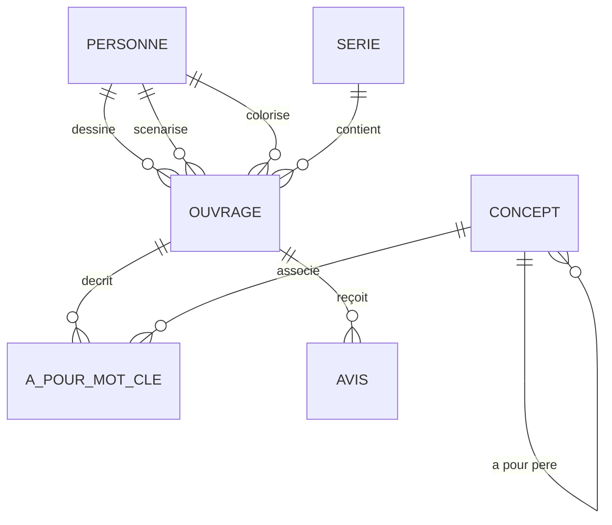

# LLM4SQL - Moteur Backend & Agent SQL Local 🚀

Ce dossier contient le moteur backend souverain de **LLM4SQL**. L'application est conçue pour fonctionner **à 100% en local** sur votre machine. Elle traduit des questions en langage naturel en requêtes SQL valides, les exécute sur une base de données PostgreSQL et utilise un agent intelligent pour s'auto-corriger en cas d'erreur.

---

## 🏗️ Architecture du Backend

Le backend repose sur une stack moderne, rapide et robuste :
1. **Python 3.12+** géré par **`uv`** (gestionnaire de dépendances de nouvelle génération, ultra-rapide).
2. **PostgreSQL v16** fonctionnant dans un conteneur **Docker** pour une flexibilité maximale.
3. **Ollama** avec le modèle **Qwen 3.5 (9B)** comme moteur d'intelligence artificielle locale.
4. **LangGraph** (prochaine phase) pour orchestrer l'agent et sa boucle d'auto-correction (*Self-Healing*).
5. **FastAPI** (prochaine phase) pour exposer l'agent via une API REST rapide et moderne.

## ⚡ Démarrage Automatisé & Optimisations (Recommandé) 🛠️

Pour vous simplifier la vie, un script d'automatisation PowerShell a été créé : **[`start_backend.ps1`](file:///c:/Users/Metzo/Documents/projet%20ia/llm4sql/backend/start_backend.ps1)**. 

### Que fait ce script automatiquement pour vous ?
1. **Active le Turbo Quant (KV Cache en 8-bit)** : Configure la variable d'environnement `$env:OLLAMA_KV_CACHE_TYPE = "q8_0"` pour diviser par 2 l'empreinte VRAM du contexte et prévenir les crashs d'Out-of-Memory.
2. **Active Flash Attention** : Force `$env:OLLAMA_FLASH_ATTENTION = "1"` pour accélérer la vitesse de calcul logique.
3. **Configure l'environnement Python** : Ajoute automatiquement le chemin local de `uv` au PATH de votre terminal.
4. **Gère l'infrastructure Docker** : Lance la base de données PostgreSQL sur le port sécurisé `5433`.
5. **Initialise vos données** : Vide et peuple les tables avec le jeu de données "BD Ouvrages" automatiquement.

### Comment l'utiliser ?
Ouvrez PowerShell et lancez simplement :
```powershell
cd "c:\Users\Metzo\Documents\projet ia\llm4sql\backend"
./start_backend.ps1
```
Et voilà ! Tout est prêt et configuré en une seule commande !

---

## 🛠️ Guide d'Installation de la Stack (Manuel)

Si vous préférez exécuter chaque étape manuellement, suivez le guide ci-dessous :

### Étape 1 : Prérequis système
Assurez-vous d'avoir installé sur votre machine :
- **Docker Desktop** : [Télécharger Docker](https://www.docker.com/products/docker-desktop/) (nécessaire pour exécuter la base de données).
- **Ollama** : [Télécharger Ollama](https://ollama.com/) (nécessaire pour faire tourner l'IA localement).

### Étape 2 : Démarrage du modèle local (Ollama)
Ouvrez un terminal Windows (PowerShell) et exécutez la commande suivante pour vous assurer que le modèle Qwen 3.5 9B est installé et prêt :
```bash
ollama run qwen3.5:9b
```
*(Si le modèle n'est pas présent, Ollama le téléchargera automatiquement depuis son registre public).*

### Étape 3 : Installation du gestionnaire `uv`
`uv` est un outil révolutionnaire qui remplace avantageusement `pip`, `pipenv` ou `poetry`.
Si vous n'avez pas installé `uv`, ouvrez PowerShell et lancez la commande suivante :
```powershell
powershell -ExecutionPolicy ByPass -c "irm https://astral.sh/uv/install.ps1 | iex"
```
Par défaut, sous Windows, `uv` s'installe dans le dossier utilisateur : `~/.local/bin/`. 
*(Note : Si la commande `uv` n'est pas reconnue par la suite, vous pouvez ajouter ce dossier au PATH système ou préfixer vos commandes par `& "$env:USERPROFILE\.local\bin\uv"`).*

### Étape 4 : Initialisation de l'environnement virtuel Python
Positionnez-vous dans le répertoire du backend :
```powershell
cd "c:\Users\Metzo\Documents\projet ia\llm4sql\backend"
```
Puis, créez et configurez l'environnement virtuel :
```powershell
# Créer le dossier .venv et synchroniser les dépendances déclarées
uv sync
```
Les dépendances clés installées incluent :
- `psycopg2-binary` (pilote de connexion PostgreSQL)
- `langgraph`, `langchain-core` et `langchain-ollama` (pour le moteur agentique)
- `fastapi` et `uvicorn` (pour l'API web)
- `mcp` (SDK du protocole Model Context Protocol d'Anthropic)

---

## 💾 La Base de Données "Ovrages BD" (Docker PostgreSQL)

### ⚠️ Gestion de conflit de port sous Windows (Pédagogie)
Par défaut, PostgreSQL s'exécute sur le port **`5432`**. Cependant, si vous avez déjà un serveur PostgreSQL installé nativement sur votre système Windows (service Windows `postgres.exe`), lancer Docker sur le port `5432` provoquera un conflit d'accès au port.

Pour résoudre cela de manière robuste et isolée :
- Notre configuration Docker est configurée pour exposer le port **`5433`** de votre machine hôte vers le port `5432` interne du conteneur.
- Votre service PostgreSQL natif Windows continue de tourner paisiblement sur le port `5432` sans aucun conflit.
- Notre application se connecte à Docker à l'adresse `127.0.0.1:5433`.

### Démarrage de la base de données
Pour démarrer la base PostgreSQL locale dans Docker, exécutez la commande suivante depuis le dossier `backend` :
```powershell
docker compose up -d
```
*(Le paramètre `-d` permet de lancer le conteneur PostgreSQL en arrière-plan sans bloquer votre terminal).*

Pour vérifier que le conteneur tourne correctement :
```powershell
docker compose ps
```
Vous devriez voir le conteneur `llm4sql-postgres` dans l'état `Up` sur le port `0.0.0.0:5433->5432/tcp`.

---

## 📊 Description du Jeu de Données (Schéma "BD Ouvrages")

La base de données simule une gestion de bandes dessinées (albums, séries, auteurs, concepts et avis lecteurs). Elle est structurée autour de **6 tables** clés :



### Les Tables en détail :
1. **`personne`** : Stocke les auteurs de BD (dessinateurs, scénaristes, coloristes).
   - `idp` (Clé primaire)
   - `nom`, `prenom`, `date_naiss`, `date_deces`
2. **`serie`** : Liste les séries d'albums (ex: *Blacksad*, *Trolls de Troy*, *Donjon*).
   - `ids` (Clé primaire)
   - `titre`
3. **`ouvrage`** : Stocke chaque album/album individuel de bande dessinée.
   - `ido` (Clé primaire)
   - `titre`, `dessinateur` (clé étrangère vers `personne`), `scenariste` (clé étrangère vers `personne`), `coloriste` (clé étrangère optionnelle), `ids` (clé étrangère optionnelle vers `serie`), `num_ordre`, `date_sortie`
4. **`concept`** : Représente des concepts thématiques hiérarchiques (ex: *animal* -> *chien*, *moyen-âge*, *philosophie*).
   - `idc` (Clé primaire)
   - `label`, `concept_pere` (clé étrangère réflexive vers `concept` pour la hiérarchie)
5. **`a_pour_mot_cle`** : Table d'association liant les ouvrages aux concepts.
   - `ido` (Clé étrangère vers `ouvrage`), `idc` (Clé étrangère vers `concept`)
6. **`avis`** : Recense les critiques et notes des lecteurs.
   - `pseudo` (Nom du lecteur), `ido` (Clé étrangère vers `ouvrage`), `score` (Note entière de 0 à 5)

### Peupler la base de données (Seed)
Pour vider d'anciennes tables et remplir la base avec le jeu de données d'ouvrages et d'avis d'exemple, exécutez :
```powershell
uv run seed_db.py
```
*Le script va automatiquement initialiser les tables et injecter les jeux de données de test.*

---

## ⚡ Lancement et Fonctionnement du POC (`test_llm_db.py`)

Le script `test_llm_db.py` sert à valider que tout le système (PostgreSQL Docker + Ollama Qwen 3.5) communique parfaitement ensemble de manière locale et souveraine.

### Comment fonctionne le POC sous le capot ?
1. **Extraction de schéma dynamique** : Le script interroge la base PostgreSQL locale pour extraire dynamiquement les noms des tables, leurs colonnes et types.
2. **Construction de Prompt enrichie** : Le script crée un Prompt système contenant la description complète de votre schéma de base de données.
3. **Appel au LLM Local** : La question en français est injectée et envoyée à Ollama (`qwen3.5:9b`).
4. **Génération SQL** : Le LLM renvoie uniquement une requête PostgreSQL propre.
5. **Exécution en base** : Le script exécute cette requête SQL directement sur votre base locale dans Docker et affiche les résultats sous forme de tableau formaté dans la console.

### Exécuter le POC
Lancez la commande suivante :
```powershell
uv run test_llm_db.py
```

### Exemple de résultat de test
Dans le script, la question posée est :
> *"Donne-moi la liste des ouvrages dessinés par Christophe Blain."*

Le modèle local Qwen 3.5 analyse le schéma, comprend la jointure complexe et génère :
```sql
SELECT o.titre
FROM ouvrage o
JOIN personne p ON o.dessinateur = p.idp
WHERE p.prenom = 'Christophe' AND p.nom = 'Blain';
```

Le script exécute la requête et vous retourne instantanément dans votre terminal :
```text
titre
--------------------
Héraclès
Ulysse
Après la pluie
Carnet d'un matelot
```

---

## 📁 Liste des Fichiers du Backend

- [`docker-compose.yml`](file:///c:/Users/Metzo/Documents/projet%20ia/llm4sql/backend/docker-compose.yml) : Configuration du conteneur PostgreSQL 16 exposant le port `5433`.
- [`seed_db.py`](file:///c:/Users/Metzo/Documents/projet%20ia/llm4sql/backend/seed_db.py) : Script Python d'initialisation et d'insertion des données de BD.
- [`test_llm_db.py`](file:///c:/Users/Metzo/Documents/projet%20ia/llm4sql/backend/test_llm_db.py) : Le script de validation (POC) traduisant la question en SQL et l'exécutant.
- [`pyproject.toml`](file:///c:/Users/Metzo/Documents/projet%20ia/llm4sql/backend/pyproject.toml) et [`uv.lock`](file:///c:/Users/Metzo/Documents/projet%20ia/llm4sql/backend/uv.lock) : Fichiers de configuration et de verrouillage des dépendances gérés par `uv`.
- [`.python-version`](file:///c:/Users/Metzo/Documents/projet%20ia/llm4sql/backend/.python-version) : Spécifie la version locale de Python utilisée (ex: 3.12).
