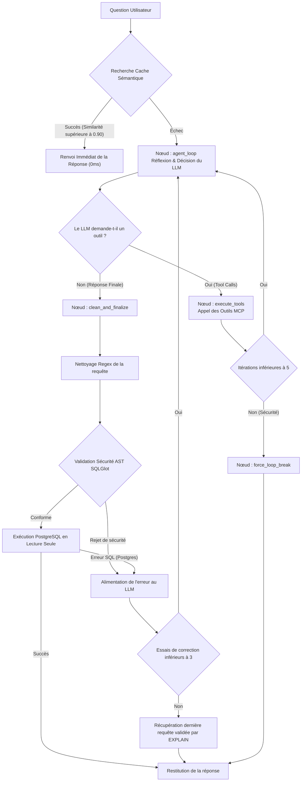

# LLM4SQL - Manuel de Référence Technique du Backend ⚙️

Ce dossier héberge le moteur de traitement local et sécurisé de **LLM4SQL**. Il gère la réception des questions utilisateurs, l'orchestration agentique de génération SQL, la validation de sécurité syntaxique, l'exécution isolée et l'optimisation des performances.

---

## 🏗️ Clean Architecture du Backend

Le code backend respecte scrupuleusement les principes du **SOLID**, du **DRY** (Don't Repeat Yourself) et de la **Clean Architecture** (Architecture Propre). L'ensemble de la logique applicative est découplée dans le package `app/`.

### Organisation Complète des Répertoires :

```text
backend/
├── app/                       # Package principal de l'application
│   ├── core/                  # Configurations globales, sécurité et utilitaires transverses
│   │   ├── config.py          # Configuration globale via pydantic-settings
│   │   ├── http_client.py     # Connection pooling HTTP global réutilisable (httpx.AsyncClient)
│   │   ├── limiter.py         # Configuration du rate-limiter global (slowapi)
│   │   └── security.py        # Validateur AST de sécurité SQL (sqlglot)
│   ├── database/              # Services d'accès à PostgreSQL
│   │   ├── pool.py            # Gestion thread-safe du pool de connexions (DRY)
│   │   ├── queries.py         # Centralisation des requêtes d'extraction de schéma & readonly
│   │   └── seed_db.py         # Script de peuplement de la BD d'exercice
│   ├── services/              # Logique métier et orchestrations intelligentes
│   │   ├── cache.py           # Service de cache schéma thread-safe
│   │   ├── eval_service.py    # Façade de réexport pour rétro-compatibilité 100%
│   │   ├── eval/              # Package d'évaluation décomposé SRP
│   │   │   ├── eval_benchmark.py  # Orchestration du benchmark et flux SSE
│   │   │   ├── eval_comparator.py # Comparaison d'Execution Accuracy & normalisation
│   │   │   └── eval_repo.py       # Persistance JSON et opérations CRUD du dataset
│   │   └── agent/             # Graphe de décision LangGraph (Le Cerveau)
│   │       ├── graph.py       # Définition et compilation du graphe de flux
│   │       ├── llm_provider.py# Singleton global de chargement paresseux d'Ollama
│   │       ├── nodes.py       # Définition unitaire des nœuds de traitement (SRP)
│   │       ├── routing.py     # Logique de routage conditionnel
│   │       ├── prompts.py     # Centralisation et versioning des prompts système
│   │       ├── schema.py      # Modèles Pydantic internes à l'agent
│   │       ├── state.py       # Modèles d'état de l'agent LangGraph
│   │       ├── tools.py       # Définition des outils exposés à l'agent
│   │       └── sql_utils.py   # Nettoyage regex des requêtes SQL brutes générées
│   ├── schemas/               # Modèles de requêtes/réponses d'API (Pydantic)
│   │   ├── chat.py            # Modèles pour le chat (validation de longueur max)
│   │   └── sandbox.py         # Modèles pour l'initialisation de la Sandbox
│   ├── routers/               # APIRouters FastAPI découpés par domaine
│   │   ├── chat.py            # Route `/api/chat` (agent intelligent SSE)
│   │   ├── monitoring.py      # Route `/api/monitoring` (métriques système et /api/health)
│   │   ├── schema.py          # Route `/api/schema` (extraction du schéma PostgreSQL)
│   │   ├── eval.py            # Route `/api/eval` (benchmark d'évaluation automatisé)
│   │   └── sandbox.py         # Routes `/api/sandbox` (DDL & visualiseur déterministe)
│   ├── mcp/                   # Implémentation du Model Context Protocol (MCP)
│   │   └── mcp_server.py      # Serveur MCP exposant les outils de lecture de schéma et requête
│   └── main.py                # Point d'entrée principal de l'application FastAPI
├── tests/                     # Suite complète de 11 fichiers de tests unitaires et intégration (pytest)
│   ├── test_agent.py          # Tests de l'agent LangGraph et boucle de Self-Healing
│   ├── test_api.py            # Tests de validation des routes FastAPI
│   ├── test_cache.py          # Tests d'isolation par schéma et éviction LRU du SemanticCache
│   ├── test_health.py         # Test unitaire de l'endpoint /api/health (Docker probe)
│   ├── test_eval.py           # Tests du moteur d'évaluation, normalisation sémantique et soft-matching
│   ├── test_eval_modules.py   # Tests unitaires des sous-modules eval_repo, eval_comparator, eval_benchmark
│   ├── test_audit_lot1.py     # Tests du connection pooling HTTP, cap combinatoire et AST DDL
│   ├── test_target_schema.py  # Tests d'isolation des schémas PostgreSQL ('public' vs 'user_sandbox')
│   ├── test_mcp.py            # Tests des outils MCP de découverte de schéma et suggestions FK
│   ├── test_mcp_security.py   # Tests unitaires du validateur SQL sécurité AST
│   └── test_security_r1.py    # Tests d'intégration, CORS et protection readonly
├── Dockerfile                 # Image conteneurisée Python 3.12-slim avec uv
├── entrypoint.sh              # Attente DB, seed automatique et démarrage Uvicorn
├── pyproject.toml             # Configuration et dépendances de l'environnement virtuel Python
├── uv.lock                    # Fichier de verrouillage des versions exactes
├── .env                       # Fichier de secrets locaux
├── .env.example               # Template des variables d'environnement
└── start_backend.ps1          # Script PowerShell de démarrage automatique et optimisations
```

---

## ⚡ Guide d'Installation & Démarrage Rapide

### 1. Installer les prérequis système
1. **Docker / Docker Desktop** : Requis pour la base PostgreSQL. [Télécharger Docker](https://www.docker.com/products/docker-desktop/).
2. **Ollama** : Requis pour exécuter le LLM localement.
   - **Windows** : [Télécharger Ollama](https://ollama.com/).
   - **Linux** : Installez la dépendance `zstd` puis Ollama :
     ```bash
     sudo apt-get install -y zstd && curl -fsSL https://ollama.com/install.sh | sh
     ```
3. **uv** : Le gestionnaire de dépendances Python ultra-rapide.
   - **Windows (PowerShell)** :
     ```powershell
     powershell -ExecutionPolicy ByPass -c "irm https://astral.sh/uv/install.ps1 | iex"
     ```
   - **Linux/macOS** :
     ```bash
     curl -LsSf https://astral.sh/uv/install.sh | sh
     ```

### 2. Télécharger le modèle de langage
Ouvrez un terminal et récupérez le modèle par défaut :
```bash
ollama run <nom_du_modele>
```

### 3. Démarrer et initialiser automatiquement le backend
Depuis le répertoire `backend/`, exécuter le script correspondant à l'environnement :

- **Sous Windows (PowerShell)** :
  ```powershell
  .\start_backend.ps1
  ```
- **Sous Linux (Bash)** :
  ```bash
  chmod +x start_backend.sh
  ./start_backend.sh
  ```

Le script effectue automatiquement la configuration matérielle d'Ollama, synchronise l'environnement virtuel Python via `uv`, démarre l'instance PostgreSQL conteneurisée, applique le seed initial et lance le serveur Uvicorn.

---

## ⚙️ Paramètres d'Accélération Matérielle Ollama
Les lanceurs injectent les variables d'environnement suivantes pour optimiser l'empreinte mémoire et la latence d'inférence :
- `OLLAMA_KV_CACHE_TYPE="q4_0"` : Quantification 4-bit du cache Key-Value (réduction de ~30% de l'empreinte VRAM sans dégradation qualitative).
- `OLLAMA_FLASH_ATTENTION="1"` : Activation du calcul Flash Attention sur accélérateurs compatibles.
- `OLLAMA_KEEP_ALIVE="-1"` : Maintien persistant du modèle en VRAM/RAM (élimination du temps de rechargement à chaud).
- `OLLAMA_NUM_PARALLEL="1"` : Allocation d'un slot unique d'inférence pour maximiser la bande passante mémoire.
- `OLLAMA_HOST="0.0.0.0:11434"` : Liaison réseau ouverte permettant la communication avec les conteneurs Docker.

---

## 🔄 Flux Logique et d'Exécution (Dataflow) de l'Agent ReAct

Le cœur de la génération SQL repose sur une architecture **ReAct (Reasoning and Action)** exécutée au sein d'un graphe d'état **LangGraph**. 

> [!IMPORTANT]
> **Recommandation Majeure : LLM avec Tool Calling Natif**
> Pour fonctionner, cet agent exige un modèle local d'Ollama supportant **nativement l'appel d'outils (Tool Calling)** (ex: `qwen3.5`). Sans cette fonctionnalité, le LLM ne pourra pas interroger les outils MCP pour explorer la base de données, et l'orchestration s'arrêtera.

Le traitement d'une question utilisateur suit le parcours dynamique suivant :



### 1. La Boîte à Outils MCP (Model Context Protocol) exposée au LLM
Grâce au mécanisme de **Tool Calling**, le LLM n'a pas à deviner la structure de la base de données. Il utilise les outils de son serveur MCP pour inspecter et valider ses requêtes en lecture seule :

| Outil MCP | Signature / Paramètres | Rôle & Comportement |
| :--- | :--- | :--- |
| **`mcp_list_tables`** | `()` | Retourne la liste exhaustive des tables du schéma actif (`public` ou `user_sandbox`). |
| **`mcp_get_schema`** | `table_name: str` | Fournit le DDL exact (`CREATE TABLE`) de la table ciblée avec types, contraintes PK/FK (approche "Diviser pour Régner"). |
| **`mcp_search_value`** | `search_term: str` | Recherche textuelle insensible à la casse (`ILIKE`) sur toutes les colonnes textuelles. Retourne les correspondances exactes et suggère les clés étrangères associées (`foreign_key_suggestion`). |
| **`mcp_get_sample_data`** | `table_name: str, limit: int = 3` | Extrait un échantillon de 3 lignes pour éclairer le format des données et la sémantique des colonnes. |
| **`mcp_dry_run_query`** | `query: str` | Exécute un `EXPLAIN` PostgreSQL sur la requête candidate. Retourne le plan d'exécution, les colonnes projetées ou le message d'erreur natif (`error`, `detail`, `hint`) sans effet de bord. |

### 2. Détail des nœuds du graphe LangGraph :

- **`node_agent_loop`** : Prépare l'historique des messages, estime la jauge de contexte, lie les outils MCP au LLM via `.bind_tools(all_tools)` et lance l'inférence. Si le streaming est actif, il extrait la réflexion `<think>` et les événements en direct.
- **`node_execute_tools`** : Inspecte la demande d'outil du LLM, exécute l'outil MCP correspondant localement, enveloppe le résultat dans un message de type `ToolMessage` et reboucle sur l'agent.
- **`node_force_loop_break`** : Coupe le traitement si l'agent entre dans une boucle infinie d'appels d'outils (limite fixée à 5 itérations).
- **`node_clean_and_finalize`** : Se lance lorsque le LLM estime avoir rédigé la requête finale. Ce nœud applique le nettoyage par Regex, valide la requête avec l'AST `SQLGlot` pour interdire toute modification de données, et l'exécute de manière sécurisée en lecture seule.
- **Boucle d'Auto-Correction (Self-Healing)** : Si l'exécution lève une erreur de base de données, l'erreur exacte est transformée en `HumanMessage` et renvoyée dans le contexte du LLM. L'agent retourne au nœud `agent_loop` pour tenter de corriger sa syntaxe. Cette boucle est limitée à **3 tentatives**.
- **Mécanisme de Repli (Fallback)** : Si la boucle d'auto-correction s'épuise sans succès, le système récupère dans l'historique la dernière requête SQL ayant passé avec succès le test d'outil `mcp_dry_run_query`, assurant qu'une requête syntaxiquement fonctionnelle soit toujours fournie.

---

## 🌐 Endpoints de l'API REST FastAPI

| Domaine | Méthode | Route | Description |
| :--- | :--- | :--- | :--- |
| **Chat** | `POST` | `/api/chat` | Traitement de question en langage naturel avec streaming SSE des étapes et tokens. |
| **Sandbox** | `POST` | `/api/sandbox/init` | Initialisation DDL & DML du schéma isolé `user_sandbox`. |
| **Sandbox** | `GET` | `/api/sandbox/schema` | Récupération du schéma et métadonnées du bac à sable. |
| **Schéma** | `GET` | `/api/schema` | Extraction du schéma de référence actif (`public`). |
| **Monitoring** | `GET` | `/api/health` | Sonde de santé applicative (utilisée par Docker Compose). |
| **Monitoring** | `GET` | `/api/ollama/status` | Statut GPU/CPU et VRAM des modèles chargés dans Ollama. |
| **Monitoring** | `GET` | `/api/ollama/models` | Liste des modèles locaux disponibles. |
| **Benchmark** | `GET` | `/api/eval/cases` | Liste des cas de test du dataset d'évaluation. |
| **Benchmark** | `POST` | `/api/eval/cases` | Ajout d'un cas de test personnalisé. |
| **Benchmark** | `PUT` | `/api/eval/cases/{id}` | Modification d'un cas de test existant. |
| **Benchmark** | `DELETE` | `/api/eval/cases/{id}` | Suppression d'un cas de test. |
| **Benchmark** | `POST` | `/api/eval/cases/reset`| Réinitialisation aux 18 cas canoniques par défaut. |
| **Benchmark** | `POST` | `/api/eval/run` | Lancement asynchrone du benchmark complet. |
| **Benchmark** | `GET` | `/api/eval/stream` | Flux SSE de suivi temps réel cas par cas. |
| **Benchmark** | `POST` | `/api/eval/stop` | Interruption immédiate et propre du benchmark. |
| **Benchmark** | `GET` | `/api/eval/history` | Historique des derniers rapports de benchmark en mémoire. |

---

## ⚡ Services Transverses d'Optimisation

### Cache Sémantique
Le backend intègre un cache sémantique en mémoire pour accélérer les requêtes récurrentes. Lors de la saisie d'une question :
1. Une requête d'embedding est envoyée à Ollama pour obtenir la représentation vectorielle.
2. La similarité cosinus est calculée avec les questions enregistrées dans le cache.
3. Si la similarité est supérieure à 0.90, la requête SQL et les résultats associés sont renvoyés immédiatement (0ms).
4. Si Ollama est indisponible ou lent pour les embeddings, un algorithme textuel de **Jaccard** basé sur l'intersection des mots-clés est exécuté en repli.

### Sécurisation Asynchrone Thread-Safe
- **ThreadPool asynchrone** : Pour éviter de bloquer la boucle d'événements de FastAPI, les requêtes bloquantes vers PostgreSQL sont encapsulées dans des threads d'arrière-plan via `asyncio.to_thread`.
- **Verrous explicites** : L'accès en lecture et en écriture au cache système du dictionnaire de schéma est protégé par un verrou `threading.Lock`, empêchant les conditions de concurrence concurrentes lors d'appels simultanés de plusieurs utilisateurs.

---

## 🧪 Suite Complète de Tests Automatisés

Le backend intègre une suite exhaustive de tests unitaires et d'intégration garantissant une non-régression absolue de l'application.

### Lancement des tests :
```powershell
uv run pytest
```

### Description des 11 fichiers de test :
- **`test_agent.py`** : Valide le graphe LangGraph ReAct, la boucle de Self-Healing face à des erreurs SQL simulées et le mécanisme de repli (Fallback) vers `mcp_dry_run_query`.
- **`test_api.py`** : Valide la conformité des routes principales FastAPI, les payloads Pydantic et le rate limiting.
- **`test_cache.py`** : Valide l'étanchéité et le partitionnement multi-schémas du cache sémantique, la similarité cosinus, le repli Jaccard et l'éviction LRU à 100 entrées.
- **`test_health.py`** : Valide l'endpoint de santé `/api/health` et son intégration avec les healthchecks Docker Compose.
- **`test_eval.py`** : Valide le moteur d'évaluation, le calcul d'Execution Accuracy, la normalisation des chaînes d'absence (`FALLBACK_NULL_STRINGS`) et le soft-matching par jetons distincts.
- **`test_eval_modules.py`** : Valide unitairement les sous-modules décomposés `eval_repo.py`, `eval_comparator.py` et `eval_benchmark.py`.
- **`test_audit_lot1.py`** : Valide le pooling HTTP global `httpx`, le cap combinatoire et le parsing DDL avec simplification universelle des types.
- **`test_target_schema.py`** : Valide le cloisonnement strict des schémas PostgreSQL (`public` vs `user_sandbox`) et le rejet des schémas non autorisés.
- **`test_mcp.py`** : Valide les outils MCP de découverte de schéma, la recherche dynamique et les suggestions de clés étrangères (`foreign_key_suggestion`).
- **`test_mcp_security.py`** : Valide le blocage strict des requêtes mutatrices (`DROP`, `UPDATE`, `DELETE`, `ALTER`) par le validateur AST SQLGlot.
- **`test_security_r1.py`** : Valide les en-têtes CORS (`DELETE`, `PUT`, `POST`, `GET`) et la protection transactionnelle en lecture seule (`readonly=True`).

