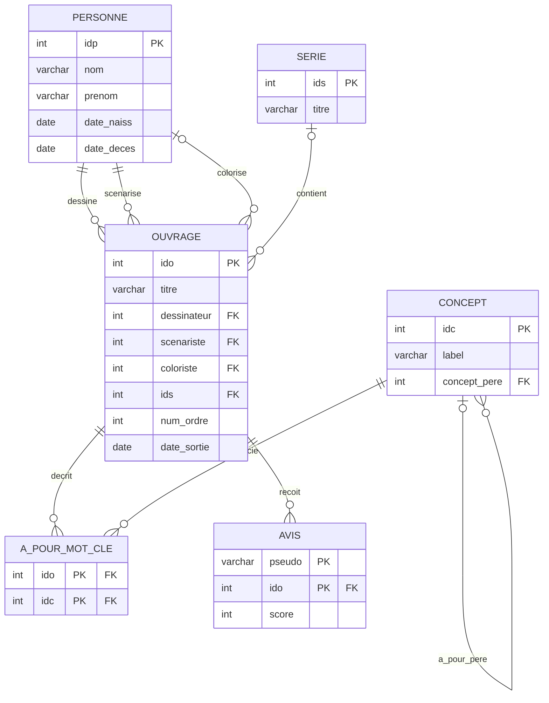

# LLM4SQL - Moteur Backend & Agent SQL Local 🚀

Ce dossier contient le moteur backend local et sécurisé de **LLM4SQL**. L'application est conçue pour fonctionner **à 100% en local** sur votre machine. Elle traduit des questions en langage naturel en requêtes SQL valides, les exécute sur une base de données PostgreSQL et utilise un agent intelligent pour s'auto-corriger en cas d'erreur.

## 🏗️ Clean Architecture du Backend

Le backend est structuré selon les principes du **SOLID**, du **DRY** (Don't Repeat Yourself) et de la **Clean Architecture** (Architecture Propre). L'ensemble du code de production est encapsulé dans le package principal `app/`, garantissant un couplage faible, une séparation stricte des responsabilités (SRP) et une lisibilité maximale.

### Organisation des Répertoires :

```text
backend/
├── app/                       # Package principal de l'application
│   ├── core/                  # Configurations globales, sécurité et utilitaires transverses
│   │   ├── config.py          # Configuration via pydantic-settings
│   │   ├── limiter.py         # Configuration du rate-limiter global (slowapi)
│   │   └── security.py        # Analyseur AST SQL pour la sécurité et blocage d'injection (sqlglot)
│   ├── database/              # Couche d'accès aux données (PostgreSQL)
│   │   ├── pool.py            # Gestion asynchrone et thread-safe du pool de connexions (DRY)
│   │   ├── queries.py         # Requêtes SQL réutilisables d'extraction de schéma
│   │   └── seed_db.py         # Script d'initialisation et peuplement de la BD Ouvrages
│   ├── services/              # Logique métier et orchestrations intelligentes
│   │   ├── cache.py           # Service de cache thread-safe pour le schéma de base de données
│   │   └── agent/             # Sous-système intelligent LangGraph
│   │       ├── graph.py       # Définition du graphe de flux LangGraph
│   │       ├── llm_provider.py# Fournisseur et configuration du LLM local (Ollama)
│   │       ├── nodes.py       # Définition unitaire des nœuds du graphe (ex: génération SQL)
│   │       ├── routing.py     # Logique d'aiguillage conditionnel du flux
│   │       ├── prompts.py     # Centralisation et versioning des prompts système
│   │       ├── schema.py      # Modèles Pydantic de données pour l'agent
│   │       ├── state.py       # Typage et gestion d'état de l'agent
│   │       ├── tools.py       # Définition des outils de l'agent (exécution SQL, etc.)
│   │       └── sql_utils.py   # Utilitaires de nettoyage et correction regex post-génération
│   ├── schemas/               # Modèles d'échange d'API (Pydantic avec max_length strict)
│   │   ├── chat.py            # Modèles pour le chat
│   │   └── sandbox.py         # Modèles pour l'initialisation et la visualisation de sandbox
│   ├── routers/               # Contrôleurs API FastAPI par domaine
│   │   ├── chat.py            # Route `/api/chat` (discussion intelligente et self-healing)
│   │   ├── monitoring.py      # Route `/api/monitoring` (métriques et journalisation)
│   │   └── sandbox.py         # Routes `/api/sandbox` (init et visualisation Mermaid déterministe)
│   ├── mcp/                   # Implémentation du Model Context Protocol (MCP) d'Anthropic
│   │   └── mcp_server.py      # Serveur MCP exposant des outils aux LLMs externes
│   └── main.py                # Point d'entrée de l'application FastAPI
├── tests/                     # Suite complète de tests automatisés (pytest)
│   ├── test_agent.py          # Tests d'intégration de l'agent LangGraph
│   ├── test_api.py            # Tests de validation des points d'accès HTTP
│   ├── test_mcp_security.py   # Tests unitaires du validateur SQL sécurité
│   └── test_security_r1.py    # Tests de non-régression de sécurité
├── pyproject.toml             # Configuration du projet et dépendances uv
├── uv.lock                    # Fichier de verrouillage des versions
├── .env                       # Configuration locale des variables d'environnement
├── .env.example               # Template d'environnement partagé
└── start_backend.ps1          # Script PowerShell de démarrage automatique et optimisations
```

### Choix de Conception & Stabilité :
- **Rate-Limiting (slowapi)** : Protection globale contre le déni de service (DoS) et la surcharge de jetons LLM, implémentée via un middleware slowapi limitant le nombre de requêtes par minute et par IP.
- **Thread-Safety (threading.Lock)** : Utilisation de verrous explicites lors de la récupération et de la mise à jour du cache de schéma, évitant tout risque de condition de concurrence (*Race Condition*) lors d'accès simultanés de l'agent LangGraph.
- **Asynchronisme Non Bloquant (`asyncio.to_thread`)** : Les opérations bloquantes du pilote de base de données synchrone (`psycopg2`) sont encapsulées dans des threads séparés via `asyncio.to_thread`, libérant la boucle d'événements principale de FastAPI.
- **Validation d'Entrées Strictes** : Tous les points d'entrée de l'API valident la longueur maximale (`max_length` Pydantic) et la structure des payloads clients pour rejeter en amont toute tentative de dépassement de tampon ou de requête démesurée.
- **Journalisation (logging standard)** : Abandon des instructions `print()` en faveur de la bibliothèque standard `logging` de Python pour une journalisation propre, filtrée par niveau et compatible avec la journalisation de production.
- **Correction SQL Déterministe** : Nettoyage et post-traitement de la requête générée par l'IA via un processeur Regex (`sql_utils.py`) pour supprimer les points-virgules de fin mal positionnés, assurant une conformité syntaxique maximale avant exécution.

## ⚡ Démarrage Automatisé & Optimisations (Recommandé) 🛠️

Pour vous simplifier la vie, un script d'automatisation PowerShell a été créé : **[`start_backend.ps1`](start_backend.ps1)**. 

### Que fait ce script automatiquement pour vous ?
1. **Optimise Ollama sous Windows** : L'application Ollama en arrière-plan sous Windows ignore les variables de session. Ce script inscrit donc de manière **permanente** (via le profil Utilisateur Windows) les variables nécessaires (`OLLAMA_KV_CACHE_TYPE="q4_0"`, `OLLAMA_FLASH_ATTENTION="1"`, `OLLAMA_KEEP_ALIVE="-1"`, `OLLAMA_NUM_PARALLEL="1"`) et redémarre silencieusement Ollama. Cela garantit que le modèle reste en mémoire vive (RAM), n'alloue qu'un seul slot de contexte et répond instantanément sans temps de chargement fastidieux !
2. **Configure l'environnement Python** : Ajoute le chemin local de `uv` au PATH de votre terminal.
3. **Gère l'infrastructure Docker** : Lance la base de données PostgreSQL sur le port sécurisé `5433`.
4. **Initialise vos données** : Vide et peuple les tables avec le jeu de données "BD Ouvrages" automatiquement via `app.database.seed_db`.

### Comment l'utiliser ?
Ouvrez PowerShell et lancez simplement :
```powershell
cd backend
.\start_backend.ps1
```
Et voilà ! Tout est prêt, configuré et optimisé en une seule commande !

---

## 🛠️ Guide d'Installation de la Stack (Manuel)

Si vous préférez exécuter chaque étape manuellement, suivez le guide ci-dessous :

### Étape 1 : Prérequis système
Assurez-vous d'avoir installé sur votre machine :
- **Docker Desktop** : [Télécharger Docker](https://www.docker.com/products/docker-desktop/) (nécessaire pour exécuter la base de données).
- **Ollama** : [Télécharger Ollama](https://ollama.com/) (nécessaire pour faire tourner l'IA localement).

### Étape 2 : Démarrage du modèle local (Ollama)
Assurez-vous que le modèle Qwen 3.5 4B est installé et prêt :
```bash
ollama run qwen3.5:4b
```

### Étape 3 : Installation du gestionnaire `uv`
`uv` est un outil de pointe pour la gestion des paquets Python. Si vous ne l'avez pas, ouvrez PowerShell et lancez :
```powershell
powershell -ExecutionPolicy ByPass -c "irm https://astral.sh/uv/install.ps1 | iex"
```

### Étape 4 : Initialisation de l'environnement virtuel Python
Positionnez-vous dans le répertoire du backend et synchronisez les dépendances déclarées dans `pyproject.toml` :
```powershell
cd backend
uv sync
```
Les dépendances clés installées incluent :
- `psycopg2-binary` (pilote PostgreSQL)
- `langgraph`, `langchain-core` et `langchain-ollama` (pour le moteur agentique LangGraph)
- `fastapi` et `uvicorn` (pour la future API web)
- `mcp` (SDK du protocole Model Context Protocol d'Anthropic)
- `pydantic-settings` (gestion de la configuration par environnement)
- `sqlglot` (analyseur AST SQL)
- `pytest` et `pytest-asyncio` (cadre de tests asynchrones)

---

## 🔌 Points d'Accès de l'API (FastAPI)

Le serveur FastAPI s'exécute par défaut sur le port **8500** (`http://127.0.0.1:8500`) (le port par défaut 8000 a été basculé sur 8500 pour éviter tout conflit avec les plages d'exclusions de ports réservées par Windows/Hyper-V) et expose les routes suivantes :

### 1. Discussion SQL Agentique & Self-Healing
- **URL :** `POST /api/chat`
- **Description :** Reçoit une question en langage naturel, la traduit en SQL, l'exécute de manière isolée et applique une boucle d'auto-correction automatique (jusqu'à 3 tentatives) via LangGraph en cas d'erreur PostgreSQL.
- **Corps de requête :**
  ```json
  {
    "question": "trouver le nom des abonnés ayant des livres non rendus..."
  }
  ```

### 2. Bac à sable SQL (Sandbox) Dynamique
- **URL :** `POST /api/sandbox/init`
- **Description :** Permet d'isoler l'utilisateur en effaçant puis en recréant un schéma PostgreSQL isolé nommé `user_sandbox`. Y exécute vos structures `CREATE TABLE` et vos scripts d'insertions `INSERT INTO` à la volée.
- **Corps de requête :**
  ```json
  {
    "schema_sql": "CREATE TABLE ...",
    "insert_sql": "INSERT INTO ..."
  }
  ```

### 3. Visualisation de Schéma (Mermaid) Déterministe
- **URL :** `POST /api/sandbox/visualize`
- **Description :** Convertit votre code SQL de création de tables brut en diagramme de relations Mermaid.js de manière 100% déterministe grâce à un analyseur syntaxique DDL écrit en Python pur (<1ms), garantissant un rendu sans erreur de syntaxe Mermaid.
- **Corps de requête :**
  ```json
  {
    "schema_sql": "CREATE TABLE ..."
  }
  ```

### 4. Récupération du Schéma Actif
- **URL :** `GET /api/schema`
- **Description :** Récupère la description textuelle structurée et mise en cache de toutes les tables actives (soit dans `user_sandbox` s'il a été initialisé, soit dans `public` par défaut).

---

## 💾 La Base de Données "Ouvrages BD" (Docker PostgreSQL)

### ⚠️ Gestion de conflit de port sous Windows (Pédagogie)
Par défaut, PostgreSQL s'exécute sur le port **`5432`**. Cependant, si vous avez déjà un serveur PostgreSQL installé nativement sur votre système Windows (service Windows `postgres.exe`), lancer Docker sur le port `5432` provoquera un conflit d'accès.
Pour résoudre cela :
- Notre configuration Docker expose le port **`5433`** de votre machine hôte vers le port `5432` interne du conteneur.
- Votre service PostgreSQL natif Windows continue de tourner sur le port `5432` sans aucun conflit.
- Notre application se connecte à Docker à l'adresse `127.0.0.1:5433`.

### Démarrage de la base de données
```powershell
docker compose up -d
```
Pour vérifier que le conteneur tourne correctement :
```powershell
docker compose ps
```

### Peupler la base de données (Seed)
Pour initialiser le schéma relationnel et y injecter les données d'exemple, exécutez la commande suivante (grâce au flag `-m`, Python gère la structure de package de manière transparente) :
```powershell
uv run -m app.database.seed_db
```

---

## 📊 Description du Jeu de Données (Schéma "BD Ouvrages")

La base de données simule une gestion de bandes dessinées (albums, séries, auteurs, concepts et avis lecteurs). Elle est structurée autour de **6 tables** clés :



### Les Tables en détail :
1. **`personne`** : Stocke les auteurs de BD (dessinateurs, scénaristes, coloristes).
2. **`serie`** : Liste les séries d'albums (ex: *Blacksad*, *Trolls de Troy*).
3. **`ouvrage`** : Stocke chaque album/ouvrage individuel de bande dessinée.
4. **`concept`** : Représente des concepts thématiques hiérarchiques (ex: *animal* -> *chien*).
5. **`a_pour_mot_cle`** : Table d'association liant les ouvrages aux concepts.
6. **`avis`** : Recense les critiques et notes des lecteurs.

---

## 🧪 Cadre de Tests Automatisés (TDD) 🟢

Pour garantir que notre code reste robuste et de qualité professionnelle, nous avons configuré un cadre de tests basé sur **`pytest`** :
1. **Validation unitaire** des syntaxes SQL générées.
2. **Validation d'intégration** avec la base de données PostgreSQL dans Docker.
3. **Tests de sécurité** pour bloquer toute commande SQL malveillante.
4. **Validation de l'agent LangGraph** et de sa boucle d'auto-correction (*Self-Healing*).

### Exécuter les tests :
Depuis le dossier `backend`, lancez la commande suivante :
```powershell
uv run pytest
```
*Le système découvrira et exécutera automatiquement tous les tests présents dans le répertoire `tests/`.*

---

## 🛡️ Audit de Santé & Sécurité (Health Audit)

Un audit complet a été réalisé et consigné dans **`health_audit.md`** à la racine de la conversation. Les points critiques pris en compte sont :
- **Sécurisation en lecture seule** : Pour la phase 2, nous avons construit un validateur SQL (`app/core/security.py`) basé sur `sqlglot` interceptant toute requête autre que `SELECT` (blocage de `DROP`, `DELETE`, `UPDATE`, `INSERT`, etc.). De plus, la connexion PostgreSQL est également forcée en mode `readonly = True` au niveau du pilote.
- **Gestion de la VRAM** : Stabilisation et réduction drastique de l'empreinte VRAM grâce à la configuration `q4_0` pour le cache KV d'Ollama.
- **Résilience** : La boucle d'auto-correction de LangGraph utilise les retours d'erreurs PostgreSQL natifs pour corriger les requêtes en temps réel (boucle limitée à 3 tentatives pour éviter toute boucle infinie).
