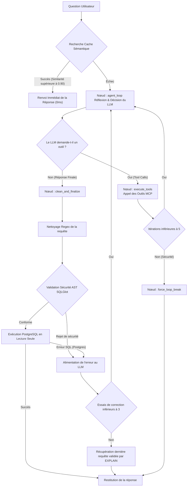

# LLM4SQL - Manuel de Référence Technique du Backend ⚙️

Ce dossier héberge le moteur de traitement local et sécurisé de **LLM4SQL**. Il gère la réception des questions utilisateurs, l'orchestration agentique de génération SQL, la validation de sécurité syntaxique, l'exécution isolée et l'optimisation des performances.

---

## 🏗️ Clean Architecture du Backend

Le code backend respecte scrupuleusement les principes du **SOLID**, du **DRY** (Don't Repeat Yourself) et de la **Clean Architecture** (Architecture Propre). L'ensemble de la logique applicative est découplée dans le package `app/`.

### Organisation Complète des Répertoires :

```text
backend/
├── app/                       # Package principal de l'application
│   ├── core/                  # Configurations globales, sécurité et utilitaires transverses
│   │   ├── config.py          # Configuration globale via pydantic-settings
│   │   ├── limiter.py         # Configuration du rate-limiter global (slowapi)
│   │   └── security.py        # Validateur AST de sécurité SQL (sqlglot)
│   ├── database/              # Services d'accès à PostgreSQL
│   │   ├── pool.py            # Gestion thread-safe du pool de connexions (DRY)
│   │   ├── queries.py         # Centralisation des requêtes d'extraction de schéma
│   │   └── seed_db.py         # Script de peuplement de la BD d'exercice
│   ├── services/              # Logique métier et orchestrations intelligentes
│   │   ├── cache.py           # Service de cache schéma thread-safe
│   │   └── agent/             # Graphe de décision LangGraph (Le Cerveau)
│   │       ├── graph.py       # Définition et compilation du graphe de flux
│   │       ├── llm_provider.py# Singleton global de chargement paresseux d'Ollama
│   │       ├── nodes.py       # Définition unitaire des nœuds de traitement (SRP)
│   │       ├── routing.py     # Logique de routage conditionnel
│   │       ├── prompts.py     # Centralisation et versioning des prompts système
│   │       ├── schema.py      # Modèles Pydantic internes à l'agent
│   │       ├── state.py       # Modèles d'état de l'agent LangGraph
│   │       ├── tools.py       # Définition des outils exposés à l'agent
│   │       └── sql_utils.py   # Nettoyage regex des requêtes SQL brutes générées
│   ├── schemas/               # Modèles de requêtes/réponses d'API (Pydantic)
│   │   ├── chat.py            # Modèles pour le chat (validation de longueur max)
│   │   └── sandbox.py         # Modèles pour l'initialisation de la Sandbox
│   ├── routers/               # APIRouters FastAPI découpés par domaine
│   │   ├── chat.py            # Route `/api/chat` (agent intelligent SSE)
│   │   ├── monitoring.py      # Route `/api/monitoring` (métriques système)
│   │   └── sandbox.py         # Routes `/api/sandbox` (DDL & visualiseur déterministe)
│   ├── mcp/                   # Implémentation du Model Context Protocol (MCP)
│   │   └── mcp_server.py      # Serveur MCP exposant les outils de lecture de schéma et requête
│   └── main.py                # Point d'entrée principal de l'application FastAPI
├── tests/                     # Suite complète de tests unitaires et intégration (pytest)
│   ├── test_agent.py          # Tests de l'agent LangGraph et boucle de Self-Healing
│   ├── test_api.py            # Tests de validation des routes FastAPI
│   ├── test_mcp_security.py   # Tests unitaires du validateur SQL sécurité
│   └── test_security_r1.py    # Tests d'intégration et de non-régression de sécurité
├── pyproject.toml             # Configuration et dépendances de l'environnement virtuel Python
├── uv.lock                    # Fichier de verrouillage des versions exactes
├── .env                       # Fichier de secrets locaux
├── .env.example               # Template des variables d'environnement
└── start_backend.ps1          # Script PowerShell de démarrage automatique et optimisations
```

---

## ⚡ Guide d'Installation & Démarrage Rapide

### 1. Installer les prérequis système
1. **Docker / Docker Desktop** : Requis pour la base PostgreSQL. [Télécharger Docker](https://www.docker.com/products/docker-desktop/).
2. **Ollama** : Requis pour exécuter le LLM localement.
   - **Windows** : [Télécharger Ollama](https://ollama.com/).
   - **Linux** : Installez la dépendance `zstd` puis Ollama :
     ```bash
     sudo apt-get install -y zstd && curl -fsSL https://ollama.com/install.sh | sh
     ```
3. **uv** : Le gestionnaire de dépendances Python ultra-rapide.
   - **Windows (PowerShell)** :
     ```powershell
     powershell -ExecutionPolicy ByPass -c "irm https://astral.sh/uv/install.ps1 | iex"
     ```
   - **Linux/macOS** :
     ```bash
     curl -LsSf https://astral.sh/uv/install.sh | sh
     ```

### 2. Télécharger le modèle de langage
Ouvrez un terminal et récupérez le modèle par défaut :
```bash
ollama run qwen3.5:4b
```

### 3. Démarrer et initialiser automatiquement le backend
Rendez-vous dans le dossier `backend/` et lancez le script correspondant à votre système :

- **Sous Windows** (PowerShell) :
  ```powershell
  .\start_backend.ps1
  ```
- **Sous Linux** (Bash) :
  ```bash
  chmod +x start_backend.sh
  ./start_backend.sh
  ```

*Ce script s'occupe de tout : il applique les optimisations d'Ollama, synchronise votre environnement virtuel Python, démarre la base PostgreSQL dans Docker, peuple les données avec le schéma d'exercice, et lance le serveur FastAPI.*

---

## ⚙️ Détails des Optimisations Appliquées (Pour information)
Les scripts `start_backend` configurent automatiquement les variables d'environnement suivantes pour maximiser les performances d'Ollama :
- `OLLAMA_KV_CACHE_TYPE="q4_0"` : Active le cache KV quantifié en 4-bit, économisant environ 30% de mémoire VRAM.
- `OLLAMA_FLASH_ATTENTION="1"` : Active Flash Attention pour accélérer l'inférence.
- `OLLAMA_KEEP_ALIVE="-1"` : Force Ollama à garder le modèle en mémoire (RAM/VRAM) indéfiniment après la première requête.
- `OLLAMA_NUM_PARALLEL="1"` : Limite le traitement parallèle à un seul slot pour optimiser le débit sur GPU grand public.

---

## 🔄 Flux Logique et d'Exécution (Dataflow) de l'Agent ReAct

Le cœur de la génération SQL repose sur une architecture **ReAct (Reasoning and Action)** exécutée au sein d'un graphe d'état **LangGraph**. 

> [!IMPORTANT]
> **Recommandation Majeure : LLM avec Tool Calling Natif**
> Pour fonctionner, cet agent exige un modèle local d'Ollama supportant **nativement l'appel d'outils (Tool Calling)** (ex: `qwen3.5`). Sans cette fonctionnalité, le LLM ne pourra pas interroger les outils MCP pour explorer la base de données, et l'orchestration s'arrêtera.

Le traitement d'une question utilisateur suit le parcours dynamique suivant :



### 1. La Boîte à Outils MCP (Model Context Protocol) exposée au LLM
Grâce au mécanisme de **Tool Calling**, le LLM n'a pas à deviner la structure de la base de données. Il peut décider de lui-même d'appeler un ou plusieurs outils de son serveur MCP pour s'orienter :
- **`mcp_list_tables`** : Fournit la liste de toutes les tables existant dans la base de données active.
- **`mcp_get_schema`** : Donne le schéma DDL complet (`CREATE TABLE`) de tables ciblées. Cela évite d'inonder le contexte du modèle avec des tables inutiles (stratégie "Diviser pour Régner").
- **`mcp_search_value`** : Permet de faire une recherche textuelle sémantique dans la base pour identifier le code ou l'identifiant exact correspondant à une valeur saisie par l'utilisateur (ex: trouver l'identifiant d'un auteur par son nom).
- **`mcp_get_sample_data`** : Récupère les 3 premières lignes d'une table pour aider le modèle à comprendre la forme concrète des données.
- **`mcp_dry_run_query`** : Exécute un `EXPLAIN` sur la requête SQL générée. Cela permet au LLM de tester la validité syntaxique de sa requête auprès de PostgreSQL sans réellement l'exécuter.

### 2. Détail des nœuds du graphe LangGraph :

- **`node_agent_loop`** : Prépare l'historique des messages, estime la jauge de contexte, lie les outils MCP au LLM via `.bind_tools(all_tools)` et lance l'inférence. Si le streaming est actif, il extrait la réflexion `<think>` et les événements en direct.
- **`node_execute_tools`** : Inspecte la demande d'outil du LLM, exécute l'outil MCP correspondant localement, enveloppe le résultat dans un message de type `ToolMessage` et reboucle sur l'agent.
- **`node_force_loop_break`** : Coupe le traitement si l'agent entre dans une boucle infinie d'appels d'outils (limite fixée à 5 itérations).
- **`node_clean_and_finalize`** : Se lance lorsque le LLM estime avoir rédigé la requête finale. Ce nœud applique le nettoyage par Regex, valide la requête avec l'AST `SQLGlot` pour interdire toute modification de données, et l'exécute de manière sécurisée en lecture seule.
- **Boucle d'Auto-Correction (Self-Healing)** : Si l'exécution lève une erreur de base de données, l'erreur exacte est transformée en `HumanMessage` et renvoyée dans le contexte du LLM. L'agent retourne au nœud `agent_loop` pour tenter de corriger sa syntaxe. Cette boucle est limitée à **3 tentatives**.
- **Mécanisme de Repli (Fallback)** : Si la boucle d'auto-correction s'épuise sans succès, le système récupère dans l'historique la dernière requête SQL ayant passé avec succès le test d'outil `mcp_dry_run_query`, assurant qu'une requête syntaxiquement fonctionnelle soit toujours fournie.

---

## ⚡ Services Transverses d'Optimisation

### Cache Sémantique
Le backend intègre un cache sémantique en mémoire pour accélérer les requêtes récurrentes. Lors de la saisie d'une question :
1. Une requête d'embedding est envoyée à Ollama pour obtenir la représentation vectorielle.
2. La similarité cosinus est calculée avec les questions enregistrées dans le cache.
3. Si la similarité est supérieure à 0.90, la requête SQL et les résultats associés sont renvoyés immédiatement (0ms).
4. Si Ollama est indisponible ou lent pour les embeddings, un algorithme textuel de **Jaccard** basé sur l'intersection des mots-clés est exécuté en repli.

### Sécurisation Asynchrone Thread-Safe
- **ThreadPool asynchrone** : Pour éviter de bloquer la boucle d'événements de FastAPI, les requêtes bloquantes vers PostgreSQL sont encapsulées dans des threads d'arrière-plan via `asyncio.to_thread`.
- **Verrous explicites** : L'accès en lecture et en écriture au cache système du dictionnaire de schéma est protégé par un verrou `threading.Lock`, empêchant les conditions de concurrence concurrentes lors d'appels simultanés de plusieurs utilisateurs.

---

## 🧪 Suite de Tests Automatisés

Le backend intègre une suite de tests robustes pour garantir la non-régression de l'application.

### Lancement des tests :
```powershell
uv run pytest
```

### Description des fichiers de test :
- `test_mcp_security.py` : Valide que le validateur AST bloque correctement les requêtes non autorisées (ex: `DROP`, `UPDATE`) et vérifie le comportement des outils MCP.
- `test_security_r1.py` : Valide la protection physique en lecture seule des connexions à la base de données.
- `test_agent.py` : Valide le graphe LangGraph, la boucle de Self-Healing face à des erreurs SQL simulées et le fonctionnement du Fallback de sécurité.
- `test_api.py` : Teste la réactivité et la conformité des routes de l'API FastAPI.
