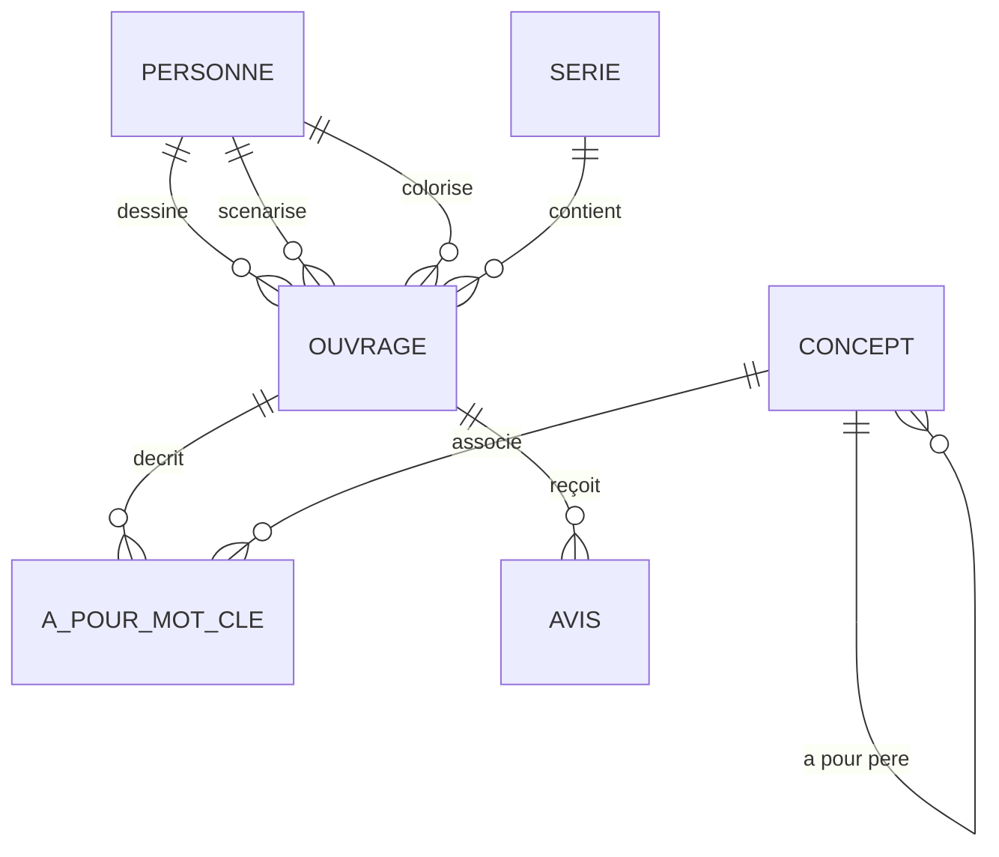

# LLM4SQL - Moteur Backend & Agent SQL Local 🚀

Ce dossier contient le moteur backend souverain de **LLM4SQL**. L'application est conçue pour fonctionner **à 100% en local** sur votre machine. Elle traduit des questions en langage naturel en requêtes SQL valides, les exécute sur une base de données PostgreSQL et utilise un agent intelligent pour s'auto-corriger en cas d'erreur.

---

## 🏗️ Clean Architecture du Backend

Le backend est structuré selon les principes du **SOLID**, du **DRY** (Don't Repeat Yourself) et de la **Clean Architecture** (Architecture Propre). L'ensemble du code de production est encapsulé dans le package principal `app/`, garantissant un couplage faible et une lisibilité maximale.

### Organisation des Répertoires :

```text
backend/
├── app/
│   ├── core/                  # Configurations globales et sécurité transverse
│   │   ├── config.py          # Gestion des variables d'environnement (pydantic-settings)
│   │   └── security.py        # Analyseur syntaxique de sécurité SQL (sqlglot)
│   ├── database/              # Services et scripts liés à la base de données
│   │   ├── connection.py      # Module d'accès centralisé à PostgreSQL (DRY)
│   │   └── seed_db.py         # Script d'initialisation et peuplement de la base BD Ouvrages
│   ├── services/              # Logique métier et Intelligence Artificielle
│   │   └── agent.py           # Graphe intelligent LangGraph (Le Cerveau)
│   └── mcp/                   # Serveur Model Context Protocol (MCP)
│       └── mcp_server.py      # Serveur MCP exposant les outils de lecture de schéma et requête
├── tests/                     # Suite de tests unitaires et d'intégration isolés
│   ├── test_mcp_security.py   # Tests du validateur SQL et des outils MCP
│   └── test_agent.py          # Tests de la logique de l'agent LangGraph et self-healing
├── pyproject.toml             # Configuration et dépendances uv
├── uv.lock                    # Fichier de verrouillage des versions
├── .env                       # Fichier de secrets locaux
├── .env.example               # Template des variables d'environnement
└── start_backend.ps1          # Script d'automatisation PowerShell pour Windows
```

---

## ⚡ Démarrage Automatisé & Optimisations (Recommandé) 🛠️

Pour vous simplifier la vie, un script d'automatisation PowerShell a été créé : **[`start_backend.ps1`](file:///c:/Users/Metzo/Documents/projet%20ia/llm4sql/backend/start_backend.ps1)**. 

### Que fait ce script automatiquement pour vous ?
1. **Active le Turbo Quant (KV Cache en 8-bit)** : Configure la variable d'environnement `$env:OLLAMA_KV_CACHE_TYPE = "q8_0"` pour diviser par 2 l'empreinte VRAM du contexte et prévenir les crashs d'Out-of-Memory.
2. **Active Flash Attention** : Force `$env:OLLAMA_FLASH_ATTENTION = "1"` pour accélérer la vitesse de calcul logique.
3. **Configure l'environnement Python** : Ajoute le chemin local de `uv` au PATH de votre terminal.
4. **Gère l'infrastructure Docker** : Lance la base de données PostgreSQL sur le port sécurisé `5433`.
5. **Initialise vos données** : Vide et peuple les tables avec le jeu de données "BD Ouvrages" automatiquement via `app.database.seed_db`.

### Comment l'utiliser ?
Ouvrez PowerShell et lancez simplement :
```powershell
cd "c:\Users\Metzo\Documents\projet ia\llm4sql\backend"
./start_backend.ps1
```
Et voilà ! Tout est prêt, configuré et testé en une seule commande !

---

## 🛠️ Guide d'Installation de la Stack (Manuel)

Si vous préférez exécuter chaque étape manuellement, suivez le guide ci-dessous :

### Étape 1 : Prérequis système
Assurez-vous d'avoir installé sur votre machine :
- **Docker Desktop** : [Télécharger Docker](https://www.docker.com/products/docker-desktop/) (nécessaire pour exécuter la base de données).
- **Ollama** : [Télécharger Ollama](https://ollama.com/) (nécessaire pour faire tourner l'IA localement).

### Étape 2 : Démarrage du modèle local (Ollama)
Assurez-vous que le modèle Qwen 3.5 9B est installé et prêt :
```bash
ollama run qwen3.5:9b
```

### Étape 3 : Installation du gestionnaire `uv`
`uv` est un outil de pointe pour la gestion des paquets Python. Si vous ne l'avez pas, ouvrez PowerShell et lancez :
```powershell
powershell -ExecutionPolicy ByPass -c "irm https://astral.sh/uv/install.ps1 | iex"
```

### Étape 4 : Initialisation de l'environnement virtuel Python
Positionnez-vous dans le répertoire du backend et synchronisez les dépendances déclarées dans `pyproject.toml` :
```powershell
cd "c:\Users\Metzo\Documents\projet ia\llm4sql\backend"
uv sync
```
Les dépendances clés installées incluent :
- `psycopg2-binary` (pilote PostgreSQL)
- `langgraph`, `langchain-core` et `langchain-ollama` (pour le moteur agentique LangGraph)
- `fastapi` et `uvicorn` (pour la future API web)
- `mcp` (SDK du protocole Model Context Protocol d'Anthropic)
- `pydantic-settings` (gestion de la configuration par environnement)
- `sqlglot` (analyseur AST SQL)
- `pytest` et `pytest-asyncio` (cadre de tests asynchrones)

---

## 💾 La Base de Données "Ouvrages BD" (Docker PostgreSQL)

### ⚠️ Gestion de conflit de port sous Windows (Pédagogie)
Par défaut, PostgreSQL s'exécute sur le port **`5432`**. Cependant, si vous avez déjà un serveur PostgreSQL installé nativement sur votre système Windows (service Windows `postgres.exe`), lancer Docker sur le port `5432` provoquera un conflit d'accès.
Pour résoudre cela :
- Notre configuration Docker expose le port **`5433`** de votre machine hôte vers le port `5432` interne du conteneur.
- Votre service PostgreSQL natif Windows continue de tourner sur le port `5432` sans aucun conflit.
- Notre application se connecte à Docker à l'adresse `127.0.0.1:5433`.

### Démarrage de la base de données
```powershell
docker compose up -d
```
Pour vérifier que le conteneur tourne correctement :
```powershell
docker compose ps
```

### Peupler la base de données (Seed)
Pour initialiser le schéma relationnel et y injecter les données d'exemple, exécutez la commande suivante (grâce au flag `-m`, Python gère la structure de package de manière transparente) :
```powershell
uv run -m app.database.seed_db
```

---

## 📊 Description du Jeu de Données (Schéma "BD Ouvrages")

La base de données simule une gestion de bandes dessinées (albums, séries, auteurs, concepts et avis lecteurs). Elle est structurée autour de **6 tables** clés :



### Les Tables en détail :
1. **`personne`** : Stocke les auteurs de BD (dessinateurs, scénaristes, coloristes).
2. **`serie`** : Liste les séries d'albums (ex: *Blacksad*, *Trolls de Troy*).
3. **`ouvrage`** : Stocke chaque album/ouvrage individuel de bande dessinée.
4. **`concept`** : Représente des concepts thématiques hiérarchiques (ex: *animal* -> *chien*).
5. **`a_pour_mot_cle`** : Table d'association liant les ouvrages aux concepts.
6. **`avis`** : Recense les critiques et notes des lecteurs.

---

## 🧪 Cadre de Tests Automatisés (TDD) 🟢

Pour garantir que notre code reste robuste et de qualité professionnelle, nous avons configuré un cadre de tests basé sur **`pytest`** :
1. **Validation unitaire** des syntaxes SQL générées.
2. **Validation d'intégration** avec la base de données PostgreSQL dans Docker.
3. **Tests de sécurité** pour bloquer toute commande SQL malveillante.
4. **Validation de l'agent LangGraph** et de sa boucle d'auto-correction (*Self-Healing*).

### Exécuter les tests :
Depuis le dossier `backend`, lancez la commande suivante :
```powershell
uv run pytest
```
*Le système découvrira et exécutera automatiquement tous les tests présents dans le répertoire `tests/`.*

---

## 🛡️ Audit de Santé & Sécurité (Health Audit)

Un audit complet a été réalisé et consigné dans **`health_audit.md`** à la racine de la conversation. Les points critiques pris en compte sont :
- **Sécurisation en lecture seule** : Pour la phase 2, nous avons construit un validateur SQL (`app/core/security.py`) basé sur `sqlglot` interceptant toute requête autre que `SELECT` (blocage de `DROP`, `DELETE`, `UPDATE`, `INSERT`, etc.). De plus, la connexion PostgreSQL est également forcée en mode `readonly = True` au niveau du pilote.
- **Gestion de la VRAM** : Stabilisation à 8 Go maximum grâce à la configuration `q8_0` pour le cache KV d'Ollama.
- **Résilience** : La boucle d'auto-correction de LangGraph utilise les retours d'erreurs PostgreSQL natifs pour corriger les requêtes en temps réel (boucle limitée à 3 tentatives pour éviter toute boucle infinie).
