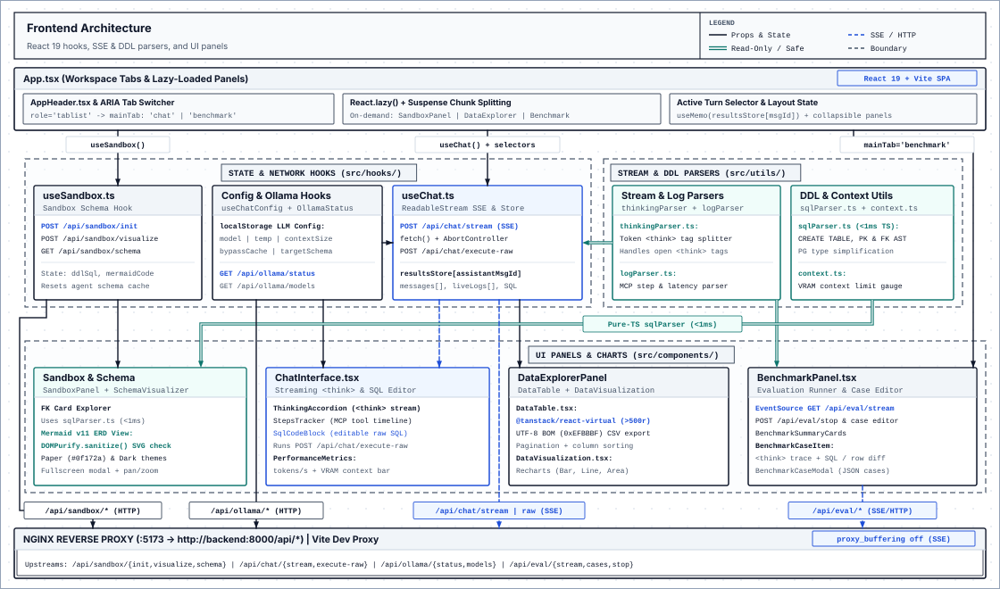

# Frontend

React 19, TypeScript, and Vite single-page app for natural language SQL querying, schema inspection, and model benchmarking.

---

## Development & Build

```bash
# Install dependencies
npm install

# Start Vite dev server with HMR at http://localhost:5173
npm run dev

# Run ESLint
npm run lint

# Type-check (tsc -b) and build production bundle into dist/
npm run build
```

### Docker / Nginx Deployment
From the repository root, `docker compose up frontend --build -d` builds the static bundle (`Node 22` -> `Nginx Alpine`), serves SPA routes via `try_files`, and proxies `/api/` to `http://backend:8000/api/` with `proxy_buffering off` so SSE chunks flush immediately.

---

## Client Architecture



- **`App.tsx`**: Switches between the 3-column `chat` workspace and the full-width `benchmark` view via ARIA tabs (`role="tablist"`). Lazy-loads `SandboxPanel`, `DataExplorerPanel`, and `BenchmarkPanel` with `React.lazy` and `Suspense`, and memoizes the active turn's dataset (`resultsStore[activeMessageId]`).
- **Hooks (`src/hooks/`)**:
  - `useChat.ts`: Consumes `POST /api/chat/stream` via `fetch()` `ReadableStream` + `AbortController` for request cancellation, executes edited SQL via `POST /api/chat/execute-raw`, and indexes query rows in `resultsStore` by assistant `messageId`.
  - `useSandbox.ts`: Calls `/api/sandbox/init`, `/api/sandbox/visualize`, and `/api/sandbox/schema` to manage the `user_sandbox` schema.
  - `useChatConfig.ts` & `useOllamaStatus.ts`: Persist LLM settings (`model`, `temperature`, `contextSize`, `bypassSemanticCache`, `selectedSchema`) in `localStorage` and poll `/api/ollama/status` and `/api/ollama/models` for VRAM split and model lists.
- **Parsers (`src/utils/`)**:
  - `thinkingParser.ts` & `logParser.ts`: Split streaming `<think>` blocks token by token (including unclosed tags mid-stream) and parse MCP step timings.
  - `sqlParser.ts` & `context.ts`: Parse `CREATE TABLE` primary/foreign keys in TypeScript (`<1ms`) with compact PostgreSQL type labels, and compute context window bar usage.
- **UI Panels (`src/components/`)**:
  - `SandboxPanel` & `SchemaVisualizer`: Keyboard-focusable FK table cards plus a `Mermaid v11` ERD viewer sanitized with `DOMPurify.sanitize()` (Paper `#0f172a` and Dark themes, fullscreen zoom).
  - `ChatInterface`: Renders `ThinkingAccordion`, `StepsTracker`, editable `SqlCodeBlock`, and `PerformanceMetrics` (`tokens/s` and context bar).
  - `DataExplorerPanel`: Combines `DataTable` (pagination, sorting, `@tanstack/react-virtual` row virtualization above 500 rows, UTF-8 BOM `\uFEFF` CSV export) and `DataVisualization` (`Recharts` bar, line, and area charts).
  - `BenchmarkPanel`: Streams `/api/eval/stream` via `EventSource`, stops runs via `POST /api/eval/stop`, and manages test cases (`BenchmarkSummaryCards`, `BenchmarkCaseItem`, `BenchmarkCaseModal`).

---

## Directory Layout

```text
frontend/
├── src/
│   ├── config/api.ts              # Backend base URL configuration
│   ├── hooks/                     # useChat, useSandbox, useChatConfig, useOllamaStatus
│   ├── components/
│   │   ├── benchmark/             # BenchmarkSummaryCards, BenchmarkCaseItem, BenchmarkCaseModal
│   │   ├── chat/                  # ChatMessage, ThinkingAccordion, StepsTracker, SqlCodeBlock, PerformanceMetrics
│   │   ├── explorer/              # DataExplorerPanel
│   │   ├── layout/                # AppHeader (tab switcher & model settings)
│   │   ├── sandbox/               # SandboxPanel (DDL/DML editor)
│   │   ├── settings/              # SettingsDropdown
│   │   ├── BenchmarkPanel.tsx     # Evaluation runner & SSE consumer
│   │   ├── ChatInterface.tsx      # Main chat panel
│   │   ├── DataTable.tsx          # Paginated / virtualized table + CSV export
│   │   ├── DataVisualization.tsx  # Recharts bar, line, and area views
│   │   └── SchemaVisualizer.tsx   # FK card view + DOMPurify-sanitized Mermaid ERD
│   ├── types/chat.ts              # Shared TypeScript interfaces
│   ├── utils/                     # thinkingParser, logParser, sqlParser, context
│   ├── App.tsx                    # Root layout and lazy-loaded panels
│   └── index.css                  # TailwindCSS v4 styles and theme tokens
├── nginx.conf                     # SPA routing and unbuffered /api/ SSE proxy
└── vite.config.ts                 # Vite + TailwindCSS v4 configuration
```

See [../ARCHITECTURE.md](../ARCHITECTURE.md) for system topology and end-to-end SSE flow.
